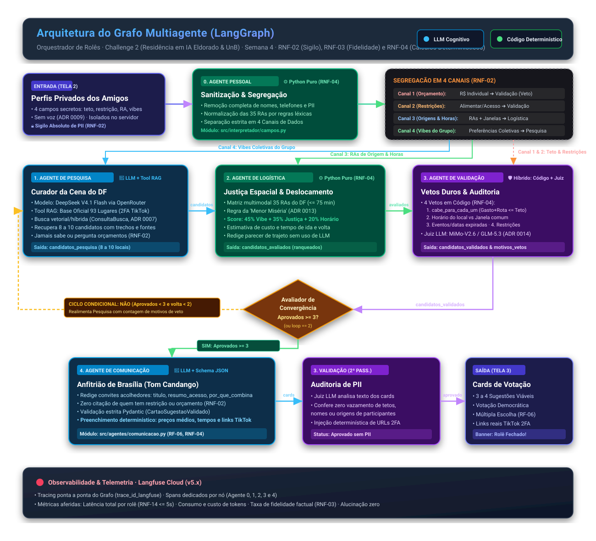

# Arquitetura do Grafo Multiagente (LangGraph)

> **Challenge 2 — Residência em IA (Instituto Eldorado & UnB)**  
> **Semana 4:** Primeiro Protótipo Funcional Multiagente  
> **Tema:** Orquestrador de Rolês no Distrito Federal  

---

## 1. Visão Geral da Arquitetura

O sistema multiagente do **Orquestrador de Rolês** é estruturado como um grafo de estados direcionado e cíclico (`StateGraph`), implementado sobre a biblioteca **LangGraph**. A arquitetura foi concebida sob o princípio fundamental de **divisão clara entre cognição e determinismo**:

1. **Agentes Cognitivos com LLM:** Atuam exclusivamente onde linguagem natural, empatia, curadoria semântica ou mediação de preferências são indispensáveis (Pesquisa, Comunicação e Juiz de Validação).
2. **Nós Determinísticos em Python Puro:** Executam todos os cálculos aritméticos, orçamentários, matrizes de tempo e restrições duras (Sanitização, Matriz de Deslocamento das 35 RAs, Menor Miséria e Vetos Duros), em estrita conformidade com o **RNF-04**.



---

## 2. Diagrama Estrutural em Mermaid

```mermaid
flowchart TD
    classDef llm fill:#e0f2fe,stroke:#0284c7,stroke-width:2px,color:#0369a1;
    classDef code fill:#dcfce7,stroke:#16a34a,stroke-width:2px,color:#15803d;
    classDef hybrid fill:#f3e8ff,stroke:#9333ea,stroke-width:2px,color:#7e22ce;
    classDef decision fill:#fef3c7,stroke:#d97706,stroke-width:2px,color:#b45309;
    classDef data fill:#ede9fe,stroke:#6366f1,stroke-width:2px,color:#4338ca;
    classDef trace fill:#f1f5f9,stroke:#64748b,stroke-width:1.5px,color:#334155;

    IN["Perfis Privados (4 Campos Secretos)<br/>• Teto Financeiro · Restrições<br/>• RA de Origem · Vibes Coletivas"]:::data --> AG0["0. AGENTE PESSOAL<br/>(Código Puro — RNF-04)<br/>• Anonimização e Eliminação de PII<br/>• Segregação Estrita em 4 Canais"]:::code

    subgraph CANAIS ["Segregação de Dados em 4 Canais (RNF-02)"]
        C1["Canal 1: Orçamento Sigiloso"]:::data
        C2["Canal 2: Restrições Duras"]:::data
        C3["Canal 3: Origens & Janelas"]:::data
        C4["Canal 4: Vibes do Grupo"]:::data
    end

    AG0 --> C1
    AG0 --> C2
    AG0 --> C3
    AG0 --> C4

    C4 -- "Vibes e Preferências Coletivas" --> AG1["1. AGENTE DE PESQUISA<br/>(LLM: DeepSeek V4.1 Flash)<br/>• Persona: Curador da Cena do DF<br/>• Tool RAG: 93 Locais 2FA TikTok<br/>• Recupera 8 a 10 Candidatos"]:::llm

    AG1 -- "candidatos_pesquisa" --> AG2["2. AGENTE DE LOGÍSTICA & JUSTIÇA<br/>(Código Puro — RNF-04, ADR 0013)<br/>• Estimativa Multimodal 35 RAs (<= 75 min)<br/>• Regra da 'Menor Miséria'<br/>• Score: 45% Vibe + 35% Justiça + 20% Horário"]:::code
    C3 -. "RAs e Horários" .-> AG2

    AG2 -- "candidatos_avaliados" --> AG3["3. AGENTE DE VALIDAÇÃO (1ª Passagem)<br/>(Híbrido: Código + Juiz LLM)<br/>• Vetos em Código: Orçamento, Horário, Eventos<br/>• Juiz LLM: GLM-5.3-Flash / MiMo-V2.6<br/>• Auditoria Factual vs 93 Lugares"]:::hybrid
    C1 -. "Teto Individual Secreto" .-> AG3
    C2 -. "Restrições Duras" .-> AG3

    AG3 --> COND{"Avaliador de Convergência<br/>Aprovados >= 3?"}:::decision

    COND -- "NÃO (e iteração < 2)<br/>[Ciclo Condicional]" -->|Feedback: Contagem de Vetos| AG1
    COND -- "SIM (ou limite de 2 voltas)" --> AG4["4. AGENTE DE COMUNICAÇÃO<br/>(LLM: Anfitrião de Brasília)<br/>• Tom Candango e Caloroso<br/>• Formatação JSON dos 3 a 4 Cartões<br/>• Preenchimento Determinístico de Preços"]:::llm

    AG4 -- "cartões gerados" --> END_VAL["3. VALIDAÇÃO (2ª Passagem)<br/>• Juiz LLM: Auditoria Anti-PII<br/>• Injeção de Links Oficiais TikTok"]:::hybrid
    END_VAL --> PUB["Aba Pública da Sala<br/>Cards da Votação Democrática (RF-06)"]:::data

    subgraph TELEMETRIA ["Observabilidade e Auditoria (Langfuse Cloud v5.x)"]
        TRACE["Traces End-to-End • Spans por Agente • Latência (RNF-14) • Custo/Tokens • Scores de Alucinação"]:::trace
    end
    AG0 -.-> TRACE
    AG1 -.-> TRACE
    AG2 -.-> TRACE
    AG3 -.-> TRACE
    AG4 -.-> TRACE
```

---

## 3. Especificação Detalhada dos Componentes

### 3.1. Agente 0 — Agente Pessoal (Sanitização e Segregação)
* **Natureza Técnica:** 100% código determinístico em Python (`src/interpretador/campos.py`), sem acionamento de modelos generativos na montagem do grupo (`RNF-04`).
* **Responsabilidade:**
  - Extração e sanitização dos 4 campos de texto secretos preenchidos por cada amigo na Tela 2 (dispensando comandos de voz, conforme ADR 0009);
  - Eliminação de qualquer Informação de Identificação Pessoal (PII: nomes reais, números de telefone, e-mails);
  - Normalização léxica das Regiões Administrativas (35 RAs do DF, incluindo apelidos e abreviações de quadras);
  - Segregação mandatória das variáveis nos **4 Canais Privados de Dados**:
    1. **Canal 1 (Orçamento Sigiloso):** Roteado unicamente para a verificação determinística de veto no Agente 3;
    2. **Canal 2 (Restrições Duras):** Roteado para a checagem de restrições alimentares e de acessibilidade física no Agente 3;
    3. **Canal 3 (Origem Geoespacial & Janelas):** Roteado para a matriz de deslocamento das 35 RAs e interseção de janelas comuns de horário no Agente 2;
    4. **Canal 4 (Vibes e Preferências Coletivas):** Agregado de forma anônima no perfil da sala e disponibilizado ao Agente 1.

### 3.2. Agente 1 — Agente de Pesquisa & Curadoria
* **Natureza Técnica:** Agente autônomo baseado em LLM (**DeepSeek V4.1 Flash** via OpenRouter) dotado de *Tool Calling* determinístico.
* **Persona & Papel:** "Curador da cena cultural, gastronômica e de lazer do Distrito Federal".
* **Mecanismo de Recuperação:** Aciona a ferramenta determinística `buscar_lugares_rag`, consultando exclusivamente a **base oficial de 93 lugares com validação em 2 fatores (2FA)** validados via TikTok (ADR 0008).
* **Garantia de Fidelidade:** Retorna entre **8 e 10 candidatos** estruturados (`candidatos_pesquisa`), onde cada afirmação traz obrigatoriamente a citação do trecho e o identificador do documento (`fonte_id`).
* **Proteção de Privacidade:** O Agente 1 não tem acesso, não sabe e não recebe o orçamento individual nem a localização privada dos membros.

### 3.3. Agente 2 — Agente de Logística & Justiça Espacial
* **Natureza Técnica:** 100% código determinístico Python (`src/agentes/logistica.py` e `src/logistica/transporte_df.py`), sem qualquer inferência por LLM (`RNF-04`).
* **Matriz de Transporte das 35 RAs:** Calcula o tempo e custo estimado de ida e volta de cada participante até cada local candidato, considerando transporte coletivo (metrô/ônibus) e carros de aplicativo, respeitando o limite teto de 75 minutos.
* **Regra da Menor Miséria (ADR 0013):** Em vez de adotar a média aritmética ingênua (que favorece o centro e sacrifica participantes de regiões periféricas como Planaltina, Ceilândia ou Santa Maria), o ranqueamento penaliza fortemente propostas que imponham trajetos excessivamente longos ou desiguais ao participante mais desfavorecido.
* **Score Ponderado do Rolê:**
  $$\text{Score} = 0{,}45 \times \text{Aderência Vibe} + 0{,}35 \times \text{Justiça Espacial} + 0{,}20 \times \text{Certeza Horário}$$
* **Emissão:** Produz `candidatos_avaliados` acompanhados de pareceres objetivos de rota.

### 3.4. Agente 3 — Agente de Validação e Consistência (1ª Passagem)
* **Natureza Técnica:** Arquitetura híbrida associando **filtros duros determinísticos** em Python com **LLM-as-a-Judge** (**GLM-5.3-Flash** / **MiMo-V2.6-Pro** via OpenRouter, ADR 0014).
* **Filtros Duros em Código (RNF-04):**
  1. `cabe_para_cada_um`: Confere individualmente se $\text{Consumo Médio Estimado} + \text{Deslocamento Individual} \le \text{Teto Individual}$ para todos os participantes (sem revelar no log coletivo quem estourou a margem);
  2. Compatibilidade de horário de funcionamento do local contra a janela de consenso do grupo (`horario_lugar.py`);
  3. Descarte de eventos pontuais ou promoções com datas já expiradas;
  4. Restrições alimentares inegociáveis (ex.: opções veganas comprovadas).
* **Auditoria Factual pelo Juiz LLM:** Avalia as asserções do Agente 1 em relação aos documentos oficiais do TikTok. Se houver contradição ou alucinação sobre cardápio ou proposta, o candidato é sumariamente expurgado.
* **Controle de Convergência & Loop Condicional:**
  - Se restarem **menos de 3 candidatos aprovados**, o nó aciona a aresta condicional de volta para o Agente 1 (limitado a **no máximo 2 iterações** para evitar loops infinitos e estouro de latência/custo);
  - A realimentação não expõe dados sensíveis: transmite unicamente o resumo anônimo da contagem de vetos (ex.: *"faltam 2 locais; 2 vetados por horário fechado, 1 por orçamento do grupo"*).

### 3.5. Agente 4 — Agente de Síntese e Comunicação
* **Natureza Técnica:** Modelo generativo via LLM configurado com System Prompt empático e acolhedor ("Anfitrião de Brasília"), complementado por injeção determinística de metadados.
* **Persona:** "Anfitrião de Brasília", comunicando-se com estilo caloroso, inclusivo e tipicamente candango.
* **Contrato Estrito de Saída:** Gera estritamente os campos descritivos (`titulo`, `resumo_acesso` e `por_que_combina`) validados via schema Pydantic (`CartaoSugestaoValidado`), impedindo alucinações de formato.
* **Blindagem de Números e Sigilo (RNF-02 e RNF-04):** A LLM é proibida de redigir valores financeiros ou tempos de deslocamento; tais campos (`custo_medio_rs`, `tempo_deslocamento_min`, endereços e URLs verificadas do TikTok) são preenchidos deterministicamente por código a partir dos objetos validados da base 2FA.

### 3.6. Validação (2ª Passagem) e Publicação
* **Auditoria de Vazamento (Anti-PII):** O Juiz LLM realiza uma varredura final no texto sintetizado pelo Agente 4, assegurando que nenhuma pista permita deduzir limitações financeiras, moradias exatas ou preferências individuais de qualquer amigo.
* **Entrega Pública:** Os **3 a 4 cartões de sugestão consolidados** são entregues na Tela 3 (`/sala/{codigo}`) para início da votação democrática de múltipla escolha (`RF-06`).

---

## 4. Estado Compartilhado do Grafo (`MultiAgentState`)

O fluxo do LangGraph transita através de uma única estrutura de estado imutável e fortemente tipada (`TypedDict`), definida em `src/agentes/estado.py`:

```python
from typing import Annotated, TypedDict
from operator import add

class MultiAgentState(TypedDict):
    sala_id: str
    
    # 1. Canais Privados (Isolados e Segregados)
    membros_privados: list[dict]        # Orçamentos, origens e restrições individuais
    
    # 2. Canal Coletivo Anonimizado
    perfil_grupo_anonimizado: dict      # Vibes agregadas, janela comum de horários
    
    # 3. Estados Intermediários do Pipeline
    candidatos_pesquisa: list[dict]     # 8 a 10 locais levantados pelo Agente 1
    candidatos_avaliados: list[dict]    # Locais ranqueados e pontuados pelo Agente 2
    candidatos_validados: list[dict]    # Locais aprovados nos vetos do Agente 3
    motivos_vetos: dict[str, int]       # Contagem de reprovações para feedback
    
    # 4. Saída Consolidada
    resultado_cartoes: list[dict]       # 3 a 4 cartões validados prontos para votação
    
    # 5. Controle de Execução e Observabilidade
    iteracao_pesquisa: int              # Contador de loops (0, 1 ou 2)
    historico_mensagens: Annotated[list[str], add]  # Log cumulativo de auditoria
    trace_id_langfuse: str              # Identificador unificado de telemetria
    trace_url: str                      # Link direto para visualização no Langfuse
```

---

## 5. Rastreabilidade e Observabilidade (Langfuse Cloud v5.x)

O grafo multiagente é instrumentado ponta a ponta com a SDK do **Langfuse Cloud**:

* **Trace Unificado:** Cada sessão de deliberação da sala gera um trace raiz único (`trace_id_langfuse`), associado ao `sala_id`.
* **Spans Dedicados:** Cada nó do LangGraph é registrado como um *span* individual (ex.: `span_agente_pesquisa`, `span_logistica_menor_miseria`, `span_validacao_juiz`, `span_comunicacao`), permitindo isolar gargalos de latência.
* **Métricas Monitoradas:**
  - **Latência Global (RNF-14):** Meta de tempo de resposta $\le 5$ segundos para montagem dos cartões;
  - **Consumo e Custo:** Contabilização exata de tokens de entrada/saída e custos em dólares/reais por chamada aos provedores OpenRouter;
  - **Fidelidade Factual (RNF-03):** Registro das notas do avaliador híbrido e taxa de rejeição por alucinação.

---

## 6. Mapeamento de Requisitos e Decisões de Arquitetura

| Requisito / ADR | Descrição | Onde é Garantido no Grafo |
| :--- | :--- | :--- |
| **RNF-02** | Sigilo Estrito do Perfil Individual | Segregação dos 4 Canais no Agente 0; Juiz LLM em 2ª Passagem no Agente 3. |
| **RNF-03** | Zero Alucinação / Grounding Factual | Agente 1 consome exclusivamente a base curada de 93 locais 2FA; Agente 3 audita evidências. |
| **RNF-04** | Cálculos Fora de Modelos de Linguagem | Agente 0 (regras), Agente 2 (matriz de transporte e Menor Miséria) e Agente 3 (vetos duros) rodam em Python puro. |
| **RNF-12** | Arquitetura Modular e Provedores Trocáveis | LangGraph com nós desacoplados; OpenRouter permitindo alternar DeepSeek, GLM, MiMo e embeddings. |
| **RNF-14** | SLA de Latência ($\le 5\text{ s}$) | Paralelização de chamadas, limitação estrita do loop condicional em até 2 voltas e spans de telemetria. |
| **RF-06** | Apresentação Clara e Votação Democrática | Agente 4 formata de 3 a 4 cartões com título, por que combina e acesso; tela pública multi-escolha. |
| **RF-17** | Orçamento Sigiloso | Função determinística `cabe_para_cada_um` checa $C + D \le T$ no Agente 3 sem expor o teto de ninguém. |
| **ADR 0008** | Base 2FA dos 93 Lugares TikTok | Tool RAG acionada pelo Agente 1 recupera apenas registros aprovados em 2 fatores. |
| **ADR 0009** | 4 Campos de Texto Secretos (Sem Voz) | Agente 0 processa texto digitado na Tela 2 sem dependência de transcrição de áudio. |
| **ADR 0013** | Regra da Menor Miséria no Deslocamento | Agente 2 ranqueia penalizando a assimetria do trajeto mais desfavorável no DF. |
| **ADR 0014** | Juiz LLM GLM-5.3-Flash / MiMo-V2.6 | Agente 3 audita afirmações com temperatura zero e sem retenção de dados. |
