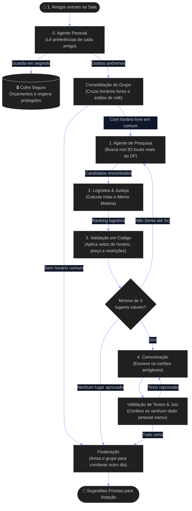

---
hide:
  - navigation
  - toc
---

# Arquitetura do Grafo Multiagente (LangGraph)

> **Como o sistema orquestra, pesquisa e recomenda os rolês no Distrito Federal de forma justa e sem vazar os segredos de ninguém.**

---

## 1. Como Funciona em Poucas Palavras

O sistema resolve um dilema comum em grupos de amigos: **escolher um lugar para sair sem ninguém passar vergonha por ter menos dinheiro ou morar longe.**

Para isso, dividimos o trabalho em dois pilares essenciais:

1. **Separação entre IA e Contas em Código:** Modelos de Linguagem (LLMs) são usados apenas para entender os pedidos do grupo, fazer buscas inteligentes e escrever os textos de forma simpática. **Todos os cálculos de dinheiro, rotas de ônibus/metrô e vetos rodam em código Python puro**, sem risco de alucinação.
2. **Cofre Seguro de Dados Pessoais:** O orçamento individual, o endereço de partida e as restrições de cada pessoa ficam guardados no **Cofre do servidor**. A IA e os outros amigos nunca descobrem quem tem orçamento mais apertado.

  <a href="../img/grafo_multiagente.svg" target="_blank" class="md-button md-button--primary">
    🔍 Abrir Diagrama Técnico em Alta Resolução (SVG)
  </a>

---

## 2. O Fluxo de Decisão dos Agentes

O diagrama abaixo mostra como os agentes conversam entre si desde a entrada do grupo até as sugestões finais:

---

## 3. O Papel de Cada Agente

Use as abas abaixo para entender o que cada agente faz de forma prática:

=== "👤 0. Agente Pessoal & Cofre"
    * **O que faz:** Lê os dados de cada amigo que entrou na sala (quanto pode gastar, onde mora, horários disponíveis e restrições alimentares).
    * **Segurança:** Guarda os orçamentos e origens direto no **Cofre Seguro**. Apenas gostos anônimos (ex: *"2 pessoas querem café"*) vão para o grupo.
    * **Como roda:** 100% código Python, sem usar inteligência artificial para evitar vazamentos.

=== "🔎 1. Agente de Pesquisa"
    * **O que faz:** Lê as preferências consolidadas do grupo e procura os melhores lugares em nossa base curada de **93 locais reais de Brasília e RAs** (comprovados por vídeos do TikTok).
    * **Zero Alucinação:** O modelo de IA é obrigado a citar trechos literais dos locais encontrados. O código Python confere se o local realmente existe antes de aprovar.
    * **Modelo:** DeepSeek V4.1 Flash via OpenRouter.

=== "🗺️ 2. Agente de Logística & Justiça"
    * **O que faz:** Calcula o trajeto de cada amigo até os locais candidatos usando as linhas de ônibus, metrô e trânsito das 35 Regiões Administrativas do DF.
    * **Regra da Menor Miséria:** O sistema prioriza locais onde o trajeto de quem mora mais longe não passe de **75 minutos**, garantindo que o rolê seja acessível para todo mundo.
    * **Como roda:** 100% código determinístico em Python.

=== "⚖️ 3. Agente de Validação & Juiz"
    * **O que faz:** Testa se os locais realmente funcionam para o grupo aplicando 5 filtros rigorosos:
        1. **Horário:** O local está aberto no horário livre do grupo?
        2. **Orçamento Secreto:** O preço médio + transporte cabe no bolso de **cada** pessoa?
        3. **Restrições:** Atende a quem tem restrições (ex: vegetariano)?
        4. **Data:** O evento ainda está ativo?
        5. **Distância:** O tempo de viagem fica dentro do limite aceitável?
    * **Juiz de Validação:** Um modelo auditor (GLM-5.3-Flash) que confere se os motivos da pesquisa condizem com os dados oficiais do local.

=== "✍️ 4. Agente de Comunicação & Telas"
    * **O que faz:** Transforma as opções aprovadas em cartões atraentes e fáceis de ler, no estilo "Anfitrião de Brasília".
    * **Proteção Dupla:** Antes de publicar, o código varre o texto caçando nomes, telefones ou pistas de dinheiro. Se o texto estiver 100% limpo, ele vai direto para a tela de votação do grupo!
    * **Modelo:** DeepSeek V4.1 Flash com persona acolhedora.

---

## 4. O Cofre Seguro vs. Estado Compartilhado

Para garantir a privacidade total dos usuários, o sistema separa rigidamente os dados:

| O que fica no Cofre Privado (🔒 Ninguém vê) | O que circula pelo Grafo Público (👥 Compartilhado) |
| :--- | :--- |
| Teto de gastos individual de cada amigo (R$) | Gostos e preferências agregadas do grupo |
| Endereço ou Região Administrativa de origem | Lista de locais candidatos encontrados |
| Restrições alimentares específicas por pessoa | Nota de justiça e tempo médio geral |
| Nomes reais e contatos pessoais | Textos finais dos cartões aprovados |

---

## 5. Resumo das Decisões Técnicas

| Requisito / ADR | Decisão Adotada | Benefício Prático |
| :--- | :--- | :--- |
| **RNF-02** | Cofre Fora do Grafo | Ninguém descobre o orçamento de quem tem menos dinheiro. |
| **RNF-03** | Base 93 Locais 2FA | A IA não inventa lugares fictícios que não existem no DF. |
| **RNF-04** | Cálculos em Código Puro | Preços e horários são calculados com precisão matemática. |
| **ADR 0013** | Regra da Menor Miséria | O rolê é justo para quem mora em qualquer RA do DF. |
| **ADR 0015** | LangGraph com nós paralelos | O processamento dos amigos ocorre ao mesmo tempo com rapidez. |
