# Arquitetura do Grafo Multiagente (LangGraph)

> **Challenge 2 — Residência em IA (Instituto Eldorado & UnB)**  
> **Semana 4:** Primeiro Protótipo Funcional Multiagente  
> **Tema:** Orquestrador de Rolês no Distrito Federal  

---

## 1. Visão Geral da Arquitetura

O sistema multiagente do **Orquestrador de Rolês** é estruturado como um grafo de estados direcionado e cíclico (`StateGraph`), implementado em [`src/agentes/grafo.py`](../../src/agentes/grafo.py) sobre a biblioteca **LangGraph** ([ADR 0015](../decisoes/0015-orquestracao-com-langgraph.md), [ADR 0016](../decisoes/0016-estrutura-dos-agentes.md)). A arquitetura segue dois princípios:

1. **Divisão entre cognição e determinismo (RNF-04):** Modelos de linguagem atuam onde seleção semântica, julgamento de apoio textual ou redação em linguagem natural são necessários (Pesquisa, Comunicação e Juiz de Validação). Todos os cálculos aritméticos, matrizes de deslocamento das 35 RAs, cruzamento de janelas, Regra da Menor Miséria e vetos duros rodam em código Python puro.
2. **Separação estrita entre estado público e cofre do servidor (RNF-02):** O estado compartilhado do grafo (`MultiAgentState`, em [`src/agentes/estado.py`](../../src/agentes/estado.py)) contém apenas marcadores anônimos (`m1..mN`), perfis sem dados sensíveis, candidatos da base e textos. Os 4 campos brutos de cada membro (nomes, tetos individuais, origens e restrições por pessoa) ficam no **`Cofre` do servidor** ([`src/agentes/contratos.py`](../../src/agentes/contratos.py)), fora do estado do grafo, preso à construção do grafo e lido unicamente pelos nós em código.


---

## 2. Diagrama Estrutural em Mermaid

O diagrama abaixo reproduz exatamente os nós e as arestas compiladas pelo LangGraph (`construir_grafo` em [`src/agentes/grafo.py`](../../src/agentes/grafo.py), correspondente a `docs/entregas/semana-04/grafo_agentes.mmd`):

```mermaid
flowchart TD
    classDef llm fill:#e0f2fe,stroke:#0284c7,stroke-width:2px,color:#0369a1;
    classDef code fill:#dcfce7,stroke:#16a34a,stroke-width:2px,color:#15803d;
    classDef hybrid fill:#f3e8ff,stroke:#9333ea,stroke-width:2px,color:#7e22ce;
    classDef decision fill:#fef3c7,stroke:#d97706,stroke-width:2px,color:#b45309;
    classDef data fill:#ede9fe,stroke:#6366f1,stroke-width:2px,color:#4338ca;
    classDef cofre fill:#fff7ed,stroke:#ea580c,stroke-width:2px,stroke-dasharray: 5 3,color:#9a3412;
    classDef trace fill:#f1f5f9,stroke:#64748b,stroke-width:1.5px,color:#334155;

    START(["__start__ · Sala com N membros confirmados"]):::data
    START -. "Send('no_pessoal', membro) ×N em paralelo" .-> PESSOAL

    PESSOAL["0. AGENTE PESSOAL ×N · no_pessoal<br/>(Código Puro — RNF-04 · span: agente_pessoal)<br/>• Interpreta os 4 campos por regras + log pessoal<br/>• Separa 4 canais: 1, 2 e 4 no Cofre; Canal 3 no estado"]:::code

    subgraph COFRE ["Cofre do Servidor (Fora do MultiAgentState — RNF-02, ADR 0015/0016)"]
        C1["Canal 1: Orçamento (teto individual) — Privado"]:::cofre
        C2["Canal 2: Restrições duras — Privado"]:::cofre
        C4["Canal 4: Logística (origem, janelas e transporte) — Privado"]:::cofre
    end

    C3["Canal 3: Preferências (tipos, vibes, evitar, pedido sanitizado)<br/>Único canal público no estado (membros_anonimos)"]:::data

    PESSOAL -. "grava canais 1, 2 e 4" .-> COFRE
    PESSOAL -- "devolve Canal 3" --> C3
    C3 --> CONSOLIDAR["ORQUESTRADOR · no_consolidar_grupo<br/>(Código Puro · span: consolidar_grupo)<br/>• Agrega tipos ('x de y'), vibes e restrições sem autor<br/>• Cruza janelas comuns no Cofre"]:::code

    CONSOLIDAR -. "depois_de_consolidar:<br/>há janela comum (≥ 2 pessoas)" .-> PESQUISA
    CONSOLIDAR -. "sem janela comum:<br/>direto para o fim" .-> FINALIZAR

    PESQUISA["1. AGENTE DE PESQUISA · no_pesquisa<br/>(LLM: DeepSeek V4.1 Flash · span: pesquisa)<br/>• LLM escreve até 3 consultas; código executa buscar_lugares_rag<br/>• Base oficial de 93 lugares 2FA TikTok (ADR 0008)<br/>• 8 a 10 candidatos com trecho_citado conferido"]:::llm

    PESQUISA -- "candidatos_pesquisa" --> LOGISTICA["2. AGENTE DE LOGÍSTICA E JUSTIÇA · no_logistica<br/>(Código Puro — RNF-04, ADR 0013 · span: logistica)<br/>• Meio mais barato em até 75 min nas 35 RAs<br/>• Regra da Menor Miséria (nota pelo pior trajeto)<br/>• Score: 45% Aderência + 35% Justiça + 20% Horário"]:::code
    C4 -. "lê origem e janelas" .-> LOGISTICA

    LOGISTICA -- "candidatos_avaliados (só agregados)" --> VALIDACAO["3. AGENTE DE VALIDAÇÃO · no_validacao<br/>(Híbrido: Código + Juiz LLM 1ª passagem opcional · span: validacao)<br/>• Vetos em código: horário, orçamento, restrição, encerrado, deslocamento > 75 min<br/>• Juiz 1ª passagem (#72, opcional, GLM-5.3-Flash): derruba motivo que contradiz documento"]:::hybrid
    C1 -. "teto individual" .-> VALIDACAO
    C2 -. "restrições duras" .-> VALIDACAO

    VALIDACAO -. "avaliar_convergencia:<br/>validados < 3 e voltas < 2<br/>PedidoNovaBusca (só contagens)" .-> PESQUISA
    VALIDACAO -. "nenhum validado após as buscas:<br/>direto para o fim" .-> FINALIZAR
    VALIDACAO -. "≥ 1 candidato validado" .-> COMUNICACAO

    COMUNICACAO["4. AGENTE DE COMUNICAÇÃO · no_comunicacao<br/>(LLM: DeepSeek V4.1 Flash · span: comunicacao)<br/>• Persona: Anfitrião de Brasília (JSON Schema estrito)<br/>• Escreve só titulo, resumo_acesso e por_que_combina<br/>• Na reescrita, só os cartões reprovados mudam"]:::llm

    COMUNICACAO -- "cartoes + fatos" --> VAL_TEXTOS["3. VALIDAÇÃO DOS TEXTOS · no_validacao_textos<br/>(Híbrido: Código + Juiz LLM 2ª passagem · span: validacao_textos)<br/>• Varredura em código (verificar_cartoes): número, nome ou RA do Cofre<br/>• Juiz 2ª passagem (#72, GLM-5.3-Flash): contradição factual e vazamento de PII"]:::hybrid

    VAL_TEXTOS -. "depois_dos_textos:<br/>reprovado e reescritas < 1 (máx. 1 reescrita)" .-> COMUNICACAO
    VAL_TEXTOS -. "aprovados, ou texto de reserva após 1 reescrita" .-> FINALIZAR

    FINALIZAR["ORQUESTRADOR · no_finalizar<br/>(Código Puro — RNF-04 · span: finalizar)<br/>• Preenche por código: preços, gastos, tempos, horário, tiktok_url e fonte 2FA<br/>• Cartão ainda reprovado recebe texto_reserva por regras<br/>• Sem cartões: emite aviso ao grupo para flexibilizar critérios"]:::code

    FINALIZAR --> END_NODE(["__end__ · Tela 3: resultado_final_cartoes ou aviso ao grupo"]):::data

    subgraph TELEMETRIA ["Observabilidade e Auditoria (Langfuse Cloud v5.x)"]
        TRACE["Spans: agente_pessoal · consolidar_grupo · pesquisa · logistica · validacao · comunicacao · validacao_textos · finalizar"]:::trace
    end
```



### Arestas do Grafo Compilado (`grafo_agentes.mmd`)

```text
__start__ -.-> no_pessoal (um por membro, via Send)    no_pessoal --> no_consolidar_grupo
no_consolidar_grupo -.-> no_pesquisa                   no_consolidar_grupo -.-> no_finalizar
no_pesquisa --> no_logistica --> no_validacao
no_validacao -.-> no_pesquisa | no_comunicacao | no_finalizar
no_comunicacao --> no_validacao_textos
no_validacao_textos -.-> no_comunicacao | no_finalizar
no_finalizar --> __end__
```

---

## 3. Especificação Detalhada dos Nós e Agentes

### 3.1. Agente 0 — Agente Pessoal (`no_pessoal` ×N) e Consolidação (`no_consolidar_grupo`)
* **Natureza Técnica:** 100% código determinístico em Python ([`src/agentes/pessoal.py`](../../src/agentes/pessoal.py) e [`src/interpretador/campos.py`](../../src/interpretador/campos.py)) na preparação do rolê (`RNF-04`). O uso de LLM no Agente Pessoal ocorre apenas **depois do rolê**, para transformar comentário pós-evento em sugestão de memória confirmada pelo usuário.
* **Execução Paralela (`Send`) e Consolidação:**
  - A aresta inicial `distribuir` dispara um `Send("no_pessoal", {"membro": m})` para cada marcador `m1..mN` em paralelo;
  - Cada instância interpreta os 4 campos da Tela 2 (sem voz, ADR 0009), mescla o log pessoal do `store` do LangGraph e separa os dados nos **4 Canais** (Seção 3.2);
  - Os canais 1, 2 e 4 são gravados diretamente em `cofre.perfis_efetivos[m.id]`; apenas o Canal 3 (`PerfilAnonimoMembro`) retorna ao estado em `membros_anonimos`;
  - O nó `no_consolidar_grupo` agrega os perfis anônimos em `preferencias_grupo` (contagens `"x de y"` por tipo, vibes, o que evitar e restrições somadas sem autor). Se não houver janela comum para pelo menos 2 pessoas (`cofre.janelas` vazio), a aresta `depois_de_consolidar` desvia direto para `no_finalizar`, sem chamar LLMs.

### 3.2. Segregação nos 4 Canais (RNF-02 e RF-17)

Conforme implementado em [`src/agentes/pessoal.py`](../../src/agentes/pessoal.py):

| Canal | Conteúdo | Destino | Público no `MultiAgentState`? |
| :--- | :--- | :--- | :--- |
| **Canal 1 (Orçamento)** | Teto individual em R$ (`Decimal`) | Vetos financeiros da Validação (`no_validacao`, código) | **Não** — fica no `Cofre` |
| **Canal 2 (Restrições)** | Restrições duras (alimentação, acessibilidade) | Vetos da Validação (`no_validacao`, código); chegam ao grupo só somadas sem autor | **Não** — por pessoa fica no `Cofre` |
| **Canal 3 (Preferências)** | Tipos, vibes, o que evitar, transporte e pedido sanitizado (`PerfilAnonimoMembro`) | `membros_anonimos` → `preferencias_grupo` → Pesquisa (`no_pesquisa`) | **Sim** — o único canal público |
| **Canal 4 (Logística)** | RA de origem, região, janelas de horário e transporte (`CanalLogistica`) | Logística (`no_logistica`) e cruzamento de janelas (código) | **Não** — fica no `Cofre` |

### 3.3. Agente 1 — Agente de Pesquisa (`no_pesquisa`)
* **Natureza Técnica:** Agente com LLM (**DeepSeek V4.1 Flash** via OpenRouter, [`src/agentes/pesquisa.py`](../../src/agentes/pesquisa.py)) acoplado à ferramenta determinística `buscar_lugares_rag` ([`src/agentes/ferramentas.py`](../../src/agentes/ferramentas.py)).
* **Planejamento sem *Tool Calling* Nativo (Decisão da #70):** Em vez de *tool calling* nativo do provedor, o LLM recebe o perfil anônimo do grupo e devolve em JSON Schema estrito até 3 consultas estruturadas; o código Python executa `buscar_lugares_rag` sobre a **base oficial de 93 lugares com validação em 2 fatores (2FA)** do TikTok (ADR 0008).
* **Seleção e Conferência Literal:** Na segunda etapa, o LLM escolhe de **8 a 10 candidatos** (`candidatos_pesquisa`) justificando cada um com `trecho_citado`, que o código confere literalmente contra o documento da base (descartando trechos inventados). Em modo offline ou falha de rede, opera por fallback determinístico.
* **Proteção de Privacidade:** Não recebe orçamento individual, RA de origem nem nomes dos participantes.

### 3.4. Agente 2 — Agente de Logística & Justiça (`no_logistica`)
* **Natureza Técnica:** 100% código determinístico em Python ([`src/agentes/logistica.py`](../../src/agentes/logistica.py) e [`src/logistica/transporte_df.py`](../../src/logistica/transporte_df.py)), sem inferência por LLM (`RNF-04`).
* **Matriz das 35 RAs e Regra da Menor Miséria (ADR 0013):** Para cada candidato, encontra a primeira janela comum em que o local abre e escolhe, para cada membro presente, o meio de transporte mais barato que chega em até **75 minutos**. A nota de justiça penaliza o pior trajeto e a assimetria entre participantes:
  $$\text{Pontuação} = 0{,}45 \times \text{Aderência} + 0{,}35 \times \text{Justiça Espacial} + 0{,}20 \times \text{Certeza de Horário}$$
* **Sigilo dos Trajetos (RNF-02):** O trajeto individual de cada membro fica guardado exclusivamente em `Cofre.analises`. Para o estado do grafo (`candidatos_avaliados`) e para o parecer textual (`gerar_parecer`), vão apenas valores agregados (pior trajeto, média e diferença), sem marcador nem RA de origem.

### 3.5. Agente 3 — Agente de Validação (`no_validacao`)
* **Natureza Técnica:** Nó híbrido ([`src/agentes/validacao.py`](../../src/agentes/validacao.py) e [`src/agentes/juiz.py`](../../src/agentes/juiz.py)) combinando **vetos duros em código Python** com a **1ª passagem opcional do Juiz LLM** (**GLM-5.3-Flash** via OpenRouter, ADR 0014).
* **5 Vetos Duros em Código (RNF-04):**
  1. `horario`: local fechado na janela comum do grupo;
  2. `orcamento` (`cabe_para_cada_um`): confere se $\text{Consumo Médio} + \text{Transporte Ida e Volta} \le \text{Teto Individual}$ para cada participante no `Cofre`, sem revelar quem vetou;
  3. `restricao`: ausência de comprovação na base para restrição inegociável do grupo (ex.: opção vegetariana/vegana);
  4. `encerrado`: evento pontual ou promoção com data já encerrada;
  5. `deslocamento`: trajeto individual acima do limite aceitável de **75 minutos** (`TEMPO_ACEITAVEL_MIN`).
* **Juiz LLM — 1ª Passagem (`juiz_parecer`, Issue #72, opcional):** Quando habilitada (`julgar_parecer_pesquisa`), audita os motivos da Pesquisa contra o documento oficial da base 2FA e derruba apenas os candidatos cujo motivo contradiz a fonte (`derrubados_pelo_juiz`).
* **Aresta Condicional `avaliar_convergencia` (3 Destinos):**
  - **`no_pesquisa`:** se houver **menos de 3 candidatos validados** e `iteracao_pesquisa < 2` (máximo de **2 voltas**), devolve um `PedidoNovaBusca` contendo apenas contagens (`faltam`, `vetos` por categoria e `ja_vistos`), nunca texto livre;
  - **`no_finalizar`:** se após as tentativas **nenhum lugar passar** (`validados == 0`, como no cenário padrão de estresse da #66), encerra direto para avisar o grupo, sem passar pela Comunicação;
  - **`no_comunicacao`:** se houver ao menos 1 candidato validado (e $\ge 3$ ou fim das 2 voltas), envia até 4 candidatos escolhidos (`selecionar_cartoes`) para redação.

### 3.6. Agente 4 — Agente de Comunicação (`no_comunicacao`)
* **Natureza Técnica:** Agente com LLM (**DeepSeek V4.1 Flash**, [`src/agentes/comunicacao.py`](../../src/agentes/comunicacao.py)) com o prompt de sistema "Anfitrião de Brasília" ([`src/agentes/prompts/comunicacao.md`](../../src/agentes/prompts/comunicacao.md)).
* **Entrada Sanitizada (`montar_fatos`):** Recebe apenas os fatos que pode afirmar de cada cartão (`fatos`) e as preferências coletivas do grupo. Gera estritamente `titulo`, `resumo_acesso` e `por_que_combina` (`CartaoTexto`), sem escrever preços, tempos individuais nem links.
* **Reescrita Seletiva:** Quando acionado em reescrita a partir de `no_validacao_textos`, reescreve **apenas os cartões reprovados**, preservando inalterados os cartões já aprovados na primeira tentativa.

### 3.7. Validação dos Textos (`no_validacao_textos`) e Finalização (`no_finalizar`)
* **Validação dos Textos (`no_validacao_textos`):** Combina duas barreiras sobre os cartões redigidos:
  1. **Varredura em Código (`verificar_cartoes`):** Caça números soltos, valores em R$, nomes ou partes de nomes dos membros e RAs de origem presentes no `Cofre`;
  2. **Juiz LLM — 2ª Passagem (`julgar_cartoes_comunicacao`, Issue #72):** Audita fidelidade aos `fatos` e ausência de pistas de PII/orçamento (com fallback determinístico em regras quando offline).
* **Laço de Reescrita (`depois_dos_textos`):** Se houver cartão reprovado e `reescritas < 1` (**no máximo 1 reescrita**), devolve para `no_comunicacao` apenas o mapa de motivos enumerados (`reprovados`). Se ainda restar reprovação após a reescrita, segue para `no_finalizar`.
* **Nó de Finalização (`no_finalizar` — Código Puro):**
  - Substitui qualquer cartão que ainda esteja em `reprovados` pelo `texto_reserva` determinístico feito por regras;
  - Constrói os objetos `Sugestao` e preenche **por código** todos os números do cartão (`consumo_rs`, `gasto_min`, `gasto_max`, `tempo_medio_min`, `tempo_max_min`, `nota_justica`, `pontuacao`), além de `tiktok_url` e `fonte` do vídeo oficial 2FA;
  - Publica `resultado_final_cartoes` (versão pública sem `por_participante`) para votação na Tela 3 (`RF-06`) ou a mensagem explicando por que nenhum cartão pôde ser gerado.

---

## 4. Estado Compartilhado (`MultiAgentState`) e Cofre do Servidor

No código ([`src/agentes/estado.py`](../../src/agentes/estado.py)), o estado que circula pelo LangGraph e o cofre privado são estritamente separados:

- **`Cofre` ([`src/agentes/contratos.py`](../../src/agentes/contratos.py)):** Guarda `membros` (com nome e perfil bruto), `perfis_efetivos` (canais 1, 2 e 4), `janelas`, `analises` (trajeto por participante) e `sugestoes` completas. Fica preso ao grafo por *closure* em `construir_grafo` e nunca entra no `MultiAgentState`.
- **Guarda de Serialização (`serializar_estado`):** Valida o estado com `EstadoSerializado` (`extra="forbid"`) e recusa com `VazamentoNoEstado` qualquer dicionário que contenha chaves privadas (`teto`, `origem`, `nome_membro`, `por_participante`, etc.) ou o nome de algum membro da sala.

Definição real de `MultiAgentState` em [`src/agentes/estado.py`](../../src/agentes/estado.py):

```python
class MultiAgentState(TypedDict, total=False):
    # entrada
    sala_id: str                                               # código da sala (não identifica ninguém)
    trace_url: str | None                                      # link do trace no Langfuse, anexado por executar()
    membros: list[str]                                         # marcadores m1..mN; o Send abre um Agente Pessoal por um
    # Agente 0 (Pessoal) -> grupo
    membros_anonimos: Annotated[list[dict], operator.add]      # PerfilAnonimoMembro (Canal 3), um por membro, em paralelo
    preferencias_grupo: dict                                   # PreferenciasGrupo: tipos e vibes agregados, restrições
    # Agente 1 (Pesquisa)
    candidatos_pesquisa: list[dict]                            # Candidato: id, motivo e trecho literal conferido
    documentos: dict[str, dict]                                # documentos da base que a Pesquisa leu, por id
    vistos: list[str]                                          # ids já devolvidos pela Pesquisa (não repetir)
    pedido_nova_busca: dict | None                             # PedidoNovaBusca: só contagens, nunca texto livre
    iteracao_pesquisa: int                                     # voltas Validação -> Pesquisa (máximo 2)
    # Agente 2 (Logística)
    candidatos_avaliados: list[dict]                           # CandidatoAvaliado: agregados de deslocamento e nota
    # Agente 3 (Validação)
    julgados: list[str]                                        # ids que já passaram pelo juiz do parecer
    relatorio_validacao: dict                                  # RelatorioValidacao: aprovados, vetos e contagem
    candidatos_validados: list[dict]                           # CandidatoAvaliado dos aprovados, na ordem do ranking
    # Agente 4 (Comunicação) e Validação dos textos
    fatos: list[dict]                                          # o que a Comunicação pode afirmar de cada cartão
    cartoes: list[dict]                                        # CartaoTexto escritos pela Comunicação
    cartoes_por_llm: bool
    reprovados: dict[str, list[str]]                           # cartão -> motivos (só enumerações)
    reescritas: int                                            # voltas Validação -> Comunicação (máximo 1)
    # saída
    resultado_final_cartoes: list[dict]                        # cartões públicos para a votação (Tela 3)
    mensagens: Annotated[list[dict], operator.add]             # Mensagem: a conversa entre os agentes
    historico_erros: Annotated[list[str], operator.add]        # vetos, reprovações e falhas, em ordem
```

---

## 5. Rastreabilidade e Observabilidade (Langfuse Cloud v5.x)

O grafo é instrumentado em [`src/agentes/grafo.py`](../../src/agentes/grafo.py) com o decorador `@_observado` e registro seletivo via `_registrar`:

* **Trace por Execução:** A função `executar` abre o span raiz `orquestrador_multiagente`, associa `session_id=cofre.sala_id` e anexa o link do trace em `trace_url` no estado final.
* **Nomes Reais dos Spans no Código:** Cada etapa do grafo gera um span próprio com entrada e saída escolhidas à mão (`capture_input=False, capture_output=False`, evitando que o estado inteiro ou dados do cofre subam para a telemetria):
  - `agente_pessoal` (um span por membro via `Send`)
  - `consolidar_grupo`
  - `pesquisa`
  - `logistica`
  - `validacao`
  - `comunicacao`
  - `validacao_textos`
  - `finalizar`
* **Métricas e SLA de Latência (RNF-14):**
  - O **RNF-14** estabelece **$\le 5\text{ s}$** para responder na conversa e **$\le 60\text{ s}$** para gerar os planos completos do grupo. Na demonstração com LLM real (issue #74), o cenário de controle levou **24,6 s** até os cartões finais, confortavelmente dentro do limite de 60 s;
  - Os spans registram versão de prompt, se usou LLM ou fallback em regras (`usou_llm`), contagens de trechos descartados, voltas de convergência e vereditos do juiz.

---

## 6. Mapeamento de Requisitos e Decisões de Arquitetura

| Requisito / ADR | Descrição | Onde é Garantido no Grafo |
| :--- | :--- | :--- |
| **RNF-02** | Sigilo Estrito do Perfil Individual | `Cofre` fora do `MultiAgentState`; `serializar_estado` bloqueia chaves privadas e nomes; varredura em código + Juiz 2ª passagem em `no_validacao_textos`. |
| **RNF-03** | Zero Alucinação / Grounding Factual | Pesquisa restrita aos 93 locais 2FA com conferência literal de `trecho_citado`; Juiz LLM em 2 passagens (`no_validacao` e `no_validacao_textos`). |
| **RNF-04** | Cálculos Fora de Modelos de Linguagem | `no_pessoal`, `no_consolidar_grupo`, `no_logistica`, vetos de `no_validacao`, varredura de `no_validacao_textos` e `no_finalizar` rodam em Python puro. |
| **RNF-12** | Arquitetura Modular e Provedores Trocáveis | LangGraph construindo sobre `src/salas` sem reescrevê-lo; `ClienteLLM` na OpenRouter alternando DeepSeek V4.1 Flash e GLM-5.3-Flash com fallback offline. |
| **RNF-14** | SLA de Latência ($\le 5\text{ s}$ conversa / $\le 60\text{ s}$ planos) | Agentes pessoais em paralelo (`Send`), máximo de 2 voltas na Pesquisa e 1 reescrita na Comunicação (24,6 s no demo com LLM da #74). |
| **RF-06** | Apresentação Clara e Votação Democrática | `no_comunicacao` redige os textos e `no_finalizar` injeta preços, tempos, `tiktok_url` e fonte para os cartões da Tela 3. |
| **RF-17** | Orçamento Sigiloso | `cabe_para_cada_um` avalia consumo + transporte contra o teto individual lendo o `Cofre` em `no_validacao`, sem expor quem vetou. |
| **ADR 0008** | Base 2FA dos 93 Lugares TikTok | `buscar_lugares_rag` consulta apenas registros curados; `no_finalizar` preenche o link oficial do vídeo. |
| **ADR 0009** | 4 Campos de Texto Secretos (Sem Voz) | `no_pessoal` interpreta os 4 campos da Tela 2 por regras determinísticas (`interpretar_campos`). |
| **ADR 0013** | Regra da Menor Miséria no Deslocamento | `no_logistica` ranqueia penalizando o pior trajeto (> 75 min gera veto de deslocamento em `no_validacao`). |
| **ADR 0014** | Juiz LLM GLM-5.3-Flash em 2 Passagens | `juiz.py` audita motivos da Pesquisa (1ª passagem opcional em `no_validacao`) e cartões da Comunicação (2ª passagem em `no_validacao_textos`). |
| **ADR 0015 / 0016** | Orquestração LangGraph e Cofre Fora do Estado | `StateGraph` com `Send`, `InMemoryStore` para log pessoal e separação entre `MultiAgentState` público e `Cofre` privado. |
