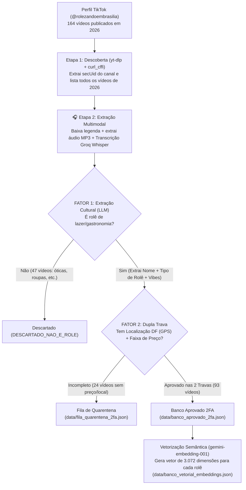

# Orquestrador de Rolês (Grupo 7 — UnB / Eldorado)
## Etapa 1: Pipeline de Web Scraping do TikTok + Autenticação de 2 Fatores (2FA) + Banco de Dados Vetorial (RAG)

Este repositório contém toda a engenharia de dados e o **Banco de Dados Vetorial** do **Orquestrador de Rolês** em Brasília/DF. A solução foi projetada para transformar vídeos reais de influenciadores locais do TikTok (`@rolezandoembrasilia`, safra completa de **2026**) em uma base vetorial auditada, geolocalizada e pronta para busca semântica (*Retrieval-Augmented Generation — RAG*).

---

## 1. Concepção e Motivação da Ideia

### O Problema
Guias tradicionais e mapas online muitas vezes estão desatualizados ou não capturam a **"vibe" real** de um lugar (se é romântico para um *date*, calmo para conversar, se tem brinquedoteca para crianças ou se está com promoção baratinha). Hoje, as pessoas descobrem onde sair assistindo a vídeos curtos no **TikTok**.

Por outro lado, usar vídeos do TikTok diretamente como banco de dados para uma Inteligência Artificial traz **3 grandes desafios**:
1. **Ruído publicitário:** Influenciadores postam vídeos de lojas de roupas, óticas, colchões ou sorteios misturados com dicas de restaurantes e passeios.
2. **Informação escondida na fala (áudio):** Em muitos vídeos, a legenda escrita no TikTok está vazia ou só tem hashtags (`#brasilia #dicas`), enquanto o nome do prato, o endereço e o preço são ditos apenas **na voz do influenciador**.
3. **Falta de dados estruturados:** Para recomendar um rolê para um grupo de amigos com orçamento limitado e calcular distâncias, a IA precisa ter certeza absoluta da **localização (endereço + GPS)** e da **faixa de preço (R$)**.

### A Solução Criada: Autenticação de Dois Fatores de Dados (2FA) + Vídeo Original + Vetorização
Para resolver isso, concebemos uma arquitetura original de **Autenticação de Dois Fatores de Dados (2FA)**:
- **Fator 1 (Extração Cultural Multimodal via IA):** O robô baixa o áudio do TikTok, transcreve o que o influenciador fala usando o modelo `whisper-large-v3-turbo` e usa um LLM (`gemini-3-flash-preview` / `qwen3.8`) para filtrar propagandas que não são de lazer e extrair 3 pilares culturais: **Nome**, **Tipo de Rolê** e **Vibes** (incluindo detecção automática de espaços *Kid Friendly*).
- **Fator 2 (Validação Geoespacial e Financeira):** Antes de entrar no banco de dados oficial, o local precisa passar por **duas travas obrigatórias**:
  - **Trava 1 (Localização):** Endereço confirmado no Distrito Federal, Região Administrativa (RA) e coordenadas GPS (`lat`, `lng`) via Google Places API / OpenStreetMap Nominatim DF.
  - **Trava 2 (Faixa de Preço):** Faixa de preço classificada (`Barato ($)`, `Moderado ($$)`, `Caro ($$$)`) e custo médio estimado por pessoa em Reais (`R$`).
- **Preservação do Link Original (`tiktok_url`):** Cada registro guarda o link direto do vídeo no TikTok para que, na etapa futura de votação do grupo, o usuário possa clicar e assistir ao vídeo real do lugar antes de votar.
- **Banco de Dados Vetorial (`gemini-embedding-001`):** Todos os locais aprovados no 2FA são convertidos em vetores matemáticos de **3.072 dimensões**, permitindo buscas por significado semântico (Cosseno de Similaridade) mesmo quando o usuário não digita as palavras exatas.

---

## 2. Arquitetura do Pipeline (Passo a Passo)



---

## 3. Taxonomia Oficial do Banco de Dados

### Fator 1: Classificação Cultural (Extraída do Vídeo + Áudio)
1. **`nome`**: Nome oficial do estabelecimento ou evento.
2. **`tipo_de_role`** (1 categoria principal dentre 5):
   - `Restaurante / Gastronomia`
   - `Bar / Boteco / Pub`
   - `Cafeteria / Doceria`
   - `Experiência / Evento`
   - `Ao Ar Livre / Parque`
3. **`vibes`** (1 ou mais tags sensoriais dentre 7):
   - `Romântico / Date`
   - `Calmo / Bom para Conversar`
   - `Intimista / Aconchegante`
   - `Baratinho`
   - `Cultural / Alternativo`
   - `Kid Friendly` *(ativada automaticamente se o vídeo/áudio mencionar brinquedoteca, espaço kids, menu infantil, parquinho ou passeio para crianças)*
   - `Animado / Galera`

### Fator 2: Validação Prática (Duas Travas Obrigatórias)
1. **Trava 1 — Localização (`trava_1_localizacao_ok: true`)**:
   - `regiao_administrativa` (ex.: *Plano Piloto (Asa Sul)*, *Taguatinga*, *Águas Claras*, *Lago Sul*)
   - `endereco` completo no DF
   - `lat` e `lng` (coordenadas GPS reais)
2. **Trava 2 — Preço (`trava_2_preco_ok: true`)**:
   - `faixa_de_preco`: `Barato ($)` (até R$ 40), `Moderado ($$)` (R$ 41 a R$ 90) ou `Caro ($$$)` (acima de R$ 90)
   - `custo_medio_rs`: Valor numérico médio por pessoa em Reais (`R$`)

---

## 4. Explicação de Cada Pasta e Arquivo do Projeto

Abaixo está a estrutura completa da pasta `banco_tiktok_df/` e a função exata de cada arquivo para a entrega no GitHub:

```text
banco_tiktok_df/
├── coletor_tiktok_2fa.py              # Script 1: Web Scraper TikTok 2026 + Whisper + Pipeline 2FA
├── banco_vetorial.py                  # Script 2: Gerador de Embeddings (3072-d) e Busca Semântica no Terminal
├── requirements.txt                   # Lista de pacotes Python necessários (yt-dlp, curl_cffi)
├── iniciar_mac_linux.sh               # Atalho de execução para macOS e Linux
├── iniciar_windows.bat                # Atalho de execução para Windows
├── .env.example                       # Modelo de configuração de chaves de API (seguro para o GitHub)
├── .gitignore                         # Protege o arquivo .env e arquivos temporários de irem para o GitHub
├── README.md                          # Documentação completa do projeto
└── data/                              # Pasta que armazena os bancos de dados (JSON e Vetorial)
    ├── catalogo_videos_2026.json      # Catálogo bruto com todos os 164 vídeos de 2026 do @rolezandoembrasilia
    ├── banco_aprovado_2fa.json        # 93 rolês aprovados no 2FA (dados estruturados + link do TikTok)
    ├── banco_vetorial_embeddings.json # BANCO VETORIAL FINAL: os 93 rolês + vetores de 3.072 dimensões
    └── fila_quarentena_2fa.json       # 24 rolês retidos por falta de preço/endereço + 47 publis descartadas
```

### Detalhamento Técnico dos Arquivos Principais:

1. **`coletor_tiktok_2fa.py` (O Motor de Captura e Auditoria 2FA):**
   - **O que faz:** Conecta ao TikTok simulando a assinatura criptográfica de um navegador real (`curl_cffi`), lista os vídeos de 2026 pelo identificador interno do canal (`secUid`), baixa o stream de áudio `.mp3` em pasta temporária, envia para transcrição no `whisper-large-v3-turbo` (Groq), executa o prompt estruturado do **Fator 1** e cruza o nome/endereço com o geocodificador e validador de preços do **Fator 2**.
   - **Onde salva:** Se `trava_1_localizacao_ok` e `trava_2_preco_ok` forem verdadeiras, salva em `data/banco_aprovado_2fa.json`. Caso contrário, retém em `data/fila_quarentena_2fa.json`.

2. **`banco_vetorial.py` (O Motor do Banco de Dados Vetorial e RAG):**
   - **O que faz:** Lê os rolês aprovados no `data/banco_aprovado_2fa.json`, monta um "documento semântico" rico para cada rolê (combinando Nome, Tipo, Vibes, Região Administrativa, Preço, Resumo Sensorial e Transcrição do Áudio) e chama a API `models/gemini-embedding-001` do Google para transformar cada lugar em uma lista de **3.072 números reais (`embedding_vector`)**.
   - **Visualização e Teste no Terminal:** Ao rodar no terminal, ele imprime os registros do banco vetorial (com as coordenadas do vetor) e executa testes ao vivo de **Similaridade de Cosseno**, provando como uma pergunta natural do usuário encontra o rolê ideal pelo significado.

3. **`data/banco_vetorial_embeddings.json` (O Banco de Dados Vetorial Persistido):**
   - **O que faz:** É o arquivo de banco de dados que o nosso site/sistema principal vai ler quando estiver pronto. Como os 93 vetores de 3.072 dimensões já estão calculados e salvos dentro dele, o sistema final pode fazer buscas vetoriais instantâneas em memória sem precisar refazer o scraping do TikTok.

---

## 5. Resultados Obtidos na Safra 2026 (`@rolezandoembrasilia`)

Foram auditados **100% dos vídeos publicados em 2026** (janeiro a novembro de 2026):

| Métrica da Safra 2026 | Quantidade | Percentual | Explicação |
| :--- | :---: | :---: | :--- |
| **Total de Vídeos Capturados (2026)** | **164** | 100% | Todos os vídeos publicados pelo perfil em 2026 |
| **Aprovados no 2FA e Vetorizados** | **93** | 56,7% | Rolês reais do DF com Fator 1 + Localização + Preço + Vetor 3072-d |
| **Retidos na Quarentena 2FA** | **24** | 14,6% | Rolês reais onde o vídeo/áudio não informou o preço ou o endereço exato |
| **Descartados (Não são Rolês)** | **47** | 28,7% | Propagandas de óticas, lojas de roupas, colchões, clínicas, etc. |

### Distribuição dos 93 Rolês Aprovados:
- **Por Tipo de Rolê:** `Restaurante / Gastronomia` (61), `Experiência / Evento` (18), `Cafeteria / Doceria` (11), `Bar / Boteco / Pub` (2), `Ao Ar Livre / Parque` (1).
- **Por Vibes:** `Animado / Galera` (58), `Baratinho` (41), `Cultural / Alternativo` (29), `Kid Friendly` (24), `Calmo / Bom para Conversar` (21), `Intimista / Aconchegante` (20), `Romântico / Date` (7).
- **Por Faixa de Preço:** `Barato ($)` (43), `Moderado ($$)` (36), `Caro ($$$)` (14).

---

## 💻 6. Como Executar no Terminal (Mac, Linux e Windows)

### Passo 1: Configurar as Chaves de API
Copie o arquivo `.env.example` para `.env` e preencha suas chaves:
```ini
GEMINI_API_KEY=sua_chave_gemini_aqui
GROQ_API_KEY=sua_chave_groq_aqui
GOOGLE_PLACES_API_KEY=opcional_sua_chave_places_aqui
```

### Passo 2: Imprimir o Banco Vetorial e Testar a Busca Semântica no Terminal
Para visualizar todos os 93 rolês aprovados, seus links do TikTok, seus vetores de 3.072 dimensões e o teste de busca vetorial:
```bash
python3 banco_vetorial.py
```

### Passo 3: Rodar o Coletor 2FA (para buscar novos vídeos)
```bash
python3 coletor_tiktok_2fa.py 15
```
*(Ou simplesmente execute `bash iniciar_mac_linux.sh` no Mac/Linux ou `iniciar_windows.bat` no Windows).*
