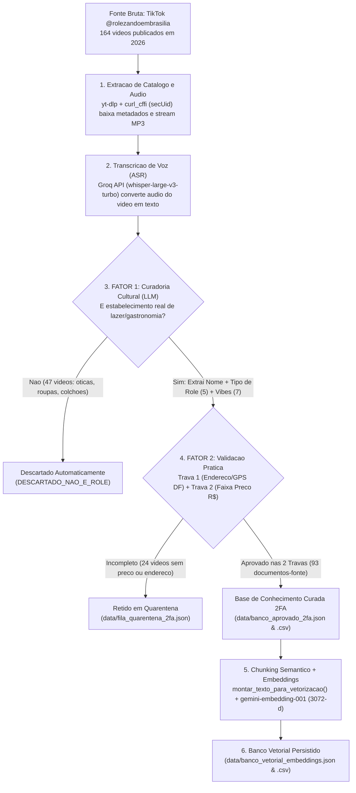
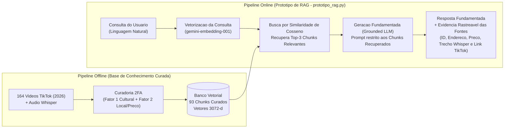

# Entregável: Base de Conhecimento + Protótipo de RAG
**RES IA ELD UNB - Turma 2 | Grupo 7 — Orquestrador de Rolês (Brasília/DF)**

Este repositório contém a entrega completa da etapa **Base de Conhecimento Curada + Protótipo de RAG**, organizada conforme os requisitos técnicos de avaliação da disciplina.

---

## 1. Checklist dos Artefatos Entregues

| Requisito do Entregável | Status no Projeto | Onde Encontrar no Repositório |
| :--- | :--- | :--- |
| **1. Base de conhecimento curada** | Concluído (Curadoria automatizada em 2 Fatores - 2FA) | `data/banco_aprovado_2fa.json` e `data/banco_aprovado_2fa.csv` |
| **2. Mínimo de 20 documentos-fonte** | **93 documentos-fonte aprovados** (extraídos de **164 vídeos de 2026** do perfil `@rolezandoembrasilia`) | `data/banco_vetorial_embeddings.json` e `data/banco_vetorial_embeddings.csv` |
| **3. Descrição da estratégia de chunking** | **Entity-Centric Semantic Chunking** (1 chunk autocontido enriquecido por estabelecimento/evento) | Seção 2 deste documento + função `montar_texto_para_vetorizacao()` em `banco_vetorial.py` |
| **4. Descrição da estratégia de embeddings** | **Google `models/gemini-embedding-001`** (Vetores densos de **3.072 dimensões** + Similaridade de Cosseno) | Seção 3 deste documento + `banco_vetorial.py` |
| **5. Implementação de um banco vetorial** | **Implementado e persistido** (93 vetores de 3.072 dimensões + busca vetorial `top-k`) | `banco_vetorial.py` + `data/banco_vetorial_embeddings.json` |
| **6. Demonstração completa (Consulta + Chunks + Resposta Fundamentada + Evidência das Fontes)** | **Protótipo RAG funcional via Terminal** com *Grounded Generation* e citação rastreável das fontes | `prototipo_rag.py` + log salvo em `DEMONSTRACAO_RAG_ENTREGAVEL.txt` |
| **7. Diagrama de arquitetura & Pipeline de ingestão** | **Documentados abaixo** (Fluxogramas completos de Ingestão 2FA e de Recuperação/Geração RAG) | Seções 4 e 5 deste documento |

---

## 2. Descrição da Estratégia de Chunking (*Entity-Centric Semantic Chunking*)

### Justificativa Técnica: Por que não utilizar *Fixed-Size Chunking*?
Na fonte de dados utilizada (vídeos curtos de 30 a 60 segundos do TikTok sobre gastronomia e lazer em Brasília), cada vídeo descreve **um único estabelecimento ou evento**. Na fala do apresentador (transcrita via *Whisper*), o **nome do local** costuma ocorrer nos primeiros segundos, a **experiência/vibe** no desenvolvimento do áudio, e o **endereço e preço** nos segundos finais.
- Um *chunking* tradicional de tamanho fixo (recorte cego por número de caracteres ou tokens) separaria o preço e o endereço do nome do estabelecimento em *chunks* distintos, causando perda de contexto (*context fragmentation*) e imprecisão na recuperação.

### Solução Adotada: *Entity-Centric Structured Semantic Chunking* (1 Documento-Fonte = 1 Chunk Autocontido)
Cada vídeo aprovado pelo protocolo de **Autenticação de 2 Fatores (2FA)** é consolidado em um **Chunk Semântico Estruturado Autocontido** (implementado na função `montar_texto_para_vetorizacao()` de `banco_vetorial.py`), integrando **4 camadas de informação**:
1. **Cabeçalho de Identidade e Categoria (Fator 1):** Nome oficial do estabelecimento + Tipo de Rolê (`Restaurante / Gastronomia`, `Bar / Boteco / Pub`, `Cafeteria / Doceria`, `Experiência / Evento` ou `Ao Ar Livre / Parque`).
2. **Camada de Ancoragem Geoespacial e Financeira (Fator 2):** Região Administrativa do DF, endereço validado, faixa de preço (`Barato ($)`, `Moderado ($$)`, `Caro ($$$)`) e valor médio em Reais (`R$`).
3. **Camada Cultural e Sensorial (Fator 1):** Tags de *Vibes* (`Romântico / Date`, `Calmo / Bom para Conversar`, `Intimista / Aconchegante`, `Baratinho`, `Cultural / Alternativo`, `Kid Friendly`, `Animado / Galera`) + Resumo Sensorial sintetizado pelo LLM.
4. **Evidência Oral Bruta (Whisper):** Trecho da transcrição do áudio original falado no vídeo (até 500 caracteres) para preservar termos específicos do cardápio (ex.: *"rodízio"*, *"brinquedoteca"*, *"zero açúcar"*, *"parrilla"*).

**Formato estrutural do Chunk Indexado:**
```text
Local: {nome} | Categoria: {tipo_de_role} | Região: {regiao_administrativa} ({endereco}) | Faixa de Preço: {faixa_de_preco} (R$ {custo_medio_rs}) | Vibes: {vibes}. {kid_friendly} | Experiência: {resumo_sensorial} | Relato do TikTok: {transcricao_audio_whisper}
```

---

## 3. Descrição da Estratégia de Embeddings e Banco Vetorial

- **Modelo de Embeddings Utilizado:** `models/gemini-embedding-001` (Google Generative Language API).
- **Dimensionalidade do Espaço Vetorial:** **3.072 dimensões** (`float` por coordenada).
- **Justificativa da Escolha do Modelo (`gemini-embedding-001`):**
  1. Alto desempenho semântico em **Português Brasileiro**, capturando expressões regionais de Brasília e equivalências conceituais (ex.: associa *"passeio iluminado para crianças"* a *"Vale Encantado / Kid Friendly"*, ou *"doce saudável sem açúcar"* a *"gelateria zero lactose"*).
  2. Alta resolução vetorial (3.072 dimensões) para distinguir nuances de atmosfera (*Romântico / Date* vs. *Animado / Galera*).
- **Armazenamento e Métrica de Busca no Banco Vetorial:**
  - Os 93 vetores de 3.072 dimensões encontram-se persistidos em **`data/banco_vetorial_embeddings.json`** e **`data/banco_vetorial_embeddings.csv`**.
  - Durante a consulta, a pergunta do usuário é vetorizada no mesmo espaço de 3.072 dimensões e comparada contra os documentos utilizando **Similaridade de Cosseno**:
    $$\text{Similaridade}(\vec{q}, \vec{d}) = \frac{\vec{q} \cdot \vec{d}}{\|\vec{q}\| \|\vec{d}\|}$$
  - O sistema recupera o **Top-$K$ ($K=3$)** de chunks com maior similaridade semântica.

---

## 4. Pipeline de Ingestão de Dados (Scraping + Whisper + Curadoria 2FA)

Para assegurar a qualidade da base de conhecimento e impedir que propagandas irrelevantes ou registros sem endereço/preço contaminem o RAG, foi implementado um pipeline automatizado de ingestão com **Autenticação de Dois Fatores de Dados (2FA)** em `coletor_tiktok_2fa.py`:



---

## 5. Diagrama de Arquitetura do Sistema (Protótipo de RAG)



---

## 6. Como Executar e Testar o Protótipo de RAG

### 6.1. Executar a Bateria Padrão de Demonstração (3 Casos de Teste)
No terminal, dentro da pasta do projeto, execute:
```bash
python3 prototipo_rag.py
```
O comando executa os **4 passos exigidos na Demonstração**:
1. Exibe a **Consulta submetida ao sistema**;
2. Exibe a **Recuperação dos Top-3 Chunks mais relevantes** do Banco Vetorial com seus respectivos Scores de Similaridade de Cosseno;
3. Gera a **Resposta fundamentada no conteúdo recuperado** (citando explicitamente `[FONTE #1]`, `[FONTE #2]`, sem extrapolar os dados recuperados);
4. Lista a **Evidência e Rastreabilidade das Fontes Utilizadas** (ID do documento, data de publicação, coordenadas GPS, faixa de preço validada, trecho da transcrição do áudio Whisper e o link direto `tiktok_url`).

*(O resultado completo dessa execução encontra-se salvo no arquivo **`DEMONSTRACAO_RAG_ENTREGAVEL.txt`** na raiz do projeto).*

### 6.2. Testar o RAG com Qualquer Pergunta Personalizada
Para submeter uma consulta específica ao RAG diretamente pelo terminal, passe a pergunta entre aspas após `python3 prototipo_rag.py`:
```bash
python3 prototipo_rag.py "Quero um lugar romantico para jantar em casal no Lago Sul ou Asa Sul"
```

---

## 7. Estrutura de Diretórios e Arquivos do Projeto

```text
Orquestrador_Roles_DF/
├── prototipo_rag.py                   # Script Principal da Demonstracao RAG (Consulta -> Retrieval -> Resposta Fundamentada -> Fontes)
├── banco_vetorial.py                  # Implementacao do Banco Vetorial (Chunking + Embeddings 3072-d + Similaridade de Cosseno)
├── coletor_tiktok_2fa.py              # Pipeline de Ingestao e Curadoria 2FA (Scraping TikTok 2026 + Whisper + Fator 1 e Fator 2)
├── DEMONSTRACAO_RAG_ENTREGAVEL.txt    # Saida completa da demonstracao dos 4 passos do RAG pronta para avaliacao
├── README.md                          # Documentacao tecnica da arquitetura, chunking, embeddings e ingestao
├── requirements.txt                   # Dependencias do projeto (yt-dlp, curl_cffi)
└── data/
    ├── banco_vetorial_embeddings.json # BANCO VETORIAL (JSON): 93 documentos curados + chunks + vetores de 3.072 dimensoes
    ├── banco_vetorial_embeddings.csv  # BANCO VETORIAL (CSV): Planilha completa incluindo a coluna embedding_vector
    ├── banco_aprovado_2fa.csv         # Planilha limpa dos 93 documentos-fonte curados (leitura em Excel/Pandas)
    ├── banco_aprovado_2fa.json        # Base de conhecimento curada em JSON (93 documentos-fonte)
    ├── fila_quarentena_2fa.json       # Registro de auditoria 2FA (24 retidos em quarentena + 47 propagandas descartadas)
    └── catalogo_videos_2026.json      # Catalogo bruto das 164 fontes coletadas de 2026
```
