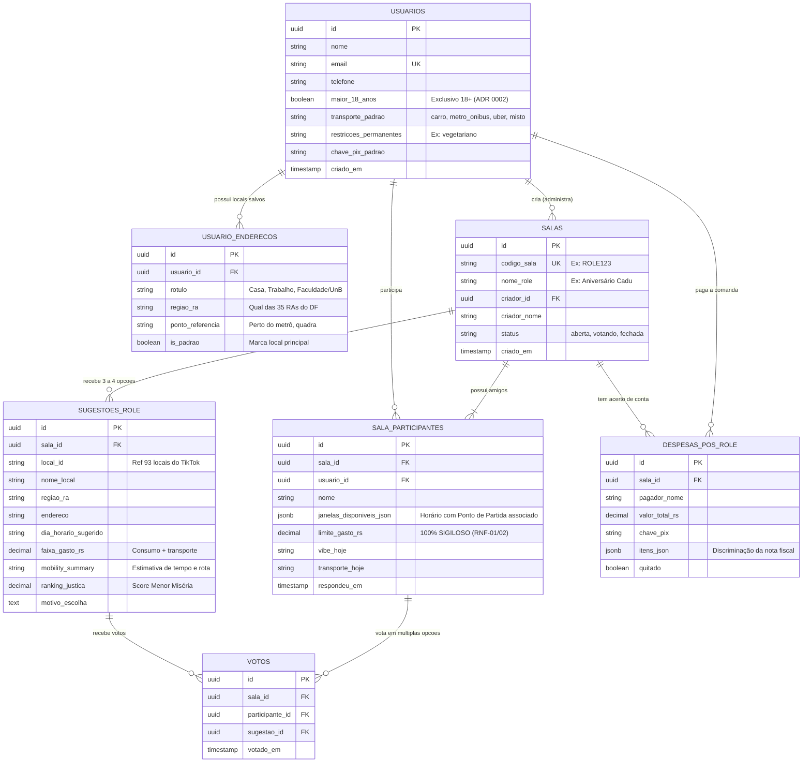

# Esquema da base de lugares e eventos

- **Versão:** 0.1 (provisória até o piloto da semana 2), 2026-11-03
- **Decisão de origem:** [ADR 0004](../decisoes/0004-fonte-e-manutencao-da-base.md)
- **Como preencher:** pelo pipeline automático do [ADR 0005](../decisoes/0005-coleta-automatica-e-base-vetorial.md); as definições do [guia de curadoria](guia-curadoria.md) são as regras de extração

## Regras gerais

- Todo campo volátil tem `fonte` (URL da página), `evidencia` (trecho literal de até 200 caracteres, interno, nunca exibido nem indexado) e `verificado_em` (data da última extração com evidência confirmada). A API de conferência nunca altera esses campos.
- Valores em reais, datas em `AAAA-MM-DD`, horários em `HH:MM` no fuso `America/Sao_Paulo`.
- Enumerações fechadas. Todo atributo aceita `sem_informacao`.
- Nenhum dado pessoal: sem telefone, e-mail, rede social ou nome de pessoa.
- `metodo` de cada campo: `overture`, `extracao_site`, `extracao_agenda` ou `calculado`. Nenhum campo é digitado por uma pessoa.

## Lugar

| Campo | Tipo | Observação |
|---|---|---|
| `id` | texto | Identificador nosso, estável (ex.: `lug-0001`) |
| `nome` | texto | Nome comercial, como o lugar se apresenta |
| `tipo_role` | `comer_beber`, `ar_livre_gratuito`, `local_evento` | Rolê em casa não tem lugar |
| `categoria` | `restaurante`, `bar`, `cafe`, `lanchonete`, `sorveteria`, `parque`, `mirante`, `feira`, `museu`, `centro_cultural`, `teatro`, `casa_de_show`, `outro` | |
| `endereco` | texto | Endereço publicado pelo próprio lugar |
| `ra`, `regiao` | texto | `regiao` conforme a tabela de 6 regiões do ADR |
| `lat`, `lon`, `coord_fonte` | número, número, `overture` ou `manual` | Nunca da Google |
| `site_oficial` | URL | Site ou perfil oficial |
| `ids_externos` | `overture_id`, `fsq_place_id` | O `google_place_id` fica em arquivo separado (ver "Arquivos") |
| `horarios` | lista de `{dia, abre, fecha}` | `dia` de `seg` a `dom`. `fecha` menor que `abre` significa que passa da meia-noite. Dia sem entrada = fechado |
| `horarios_excecoes` | lista de `{data, abre, fecha}` ou `{data, fechado: true}` | Feriados e datas especiais |
| `horarios_fonte`, `horarios_verificado_em` | URL ou canal, data | |
| `itens_referencia` | lista de `{item, preco, papel}` | `papel`: `principal`, `bebida_nao_alcoolica`, `bebida`, `porcao`, `acompanhamento`, `ingresso` |
| `couvert`, `taxa_servico_pct`, `consumacao_minima` | número ou `null` | `null` = não cobra |
| `precos_fonte`, `precos_verificado_em` | URL, data | |
| `custo_pessoa_min`, `custo_pessoa_tipico` | número | **Calculados pelo script** com a fórmula do guia; nunca digitados |
| `taxa_entrada` | número | Zero quando é gratuito |
| `atributos` | ver abaixo | Cada um com `sim`, `nao` ou `sem_informacao` |
| `atributos_verificado_em` | data | |
| `itens_para_levar` | lista de texto | Herdada da categoria (ex.: parque: água, protetor), ajustável |
| `status` | `ativo`, `fechado_temporariamente`, `fechado`, `em_reconferencia` | |
| `status_verificado_em`, `status_fonte` | data, URL ou canal | Só verificação humana |
| `descricao` | texto de até 300 caracteres | Gerada pelo LLM só a partir dos campos validados, com o modelo do guia; não copia texto do site |
| `licenca_origem` | texto | Licença do registro da Overture (ex.: `CDLA-Permissive-2.0`) |
| `pipeline_versao`, `modelo_extracao`, `criado_em`, `atualizado_em` | texto, texto, data, data | Rastreabilidade de quem (qual versão do pipeline) gerou o registro |

### Atributos

| Atributo | Valores | Uso |
|---|---|---|
| `ar_livre` | sim, não, sem informação | RF-44, preferências |
| `coberto` | sim, não, sem informação | RF-46 (chuva) |
| `ruido` | `baixo`, `medio`, `alto`, `sem_informacao` | RF-44 |
| `foco_alcool` | sim, não, sem informação | RNF-16 |
| `acess_entrada_sem_degrau` | sim, não, sem informação | Filtro duro (RF-17) |
| `acess_banheiro_adaptado` | sim, não, sem informação | Filtro duro (RF-17) |
| `alim_vegetariano`, `alim_vegano`, `alim_sem_gluten`, `alim_sem_lactose` | sim, não, sem informação | Filtro duro (RF-17); mesma lista do perfil (RF-01) |
| `grupo_max` | número ou `sem_informacao` | Salas grandes |
| `exige_reserva` | sim, não, sem informação | Texto do plano |

## Evento

| Campo | Tipo | Observação |
|---|---|---|
| `id`, `local_id` | texto | `local_id` aponta para um lugar de `tipo_role = local_evento` ou de outro tipo (ex.: feira num parque) |
| `titulo` | texto | |
| `inicio`, `fim` | data e hora | |
| `preco_min`, `preco_max`, `meia_entrada` | número, número, sim ou não | Zero = gratuito |
| `lote` | texto ou `null` | Lote vigente na verificação |
| `esgotado`, `cancelado` | sim ou não | |
| `local_alterado` | sim ou não | Se sim, `local_id` já aponta para o novo local |
| `foco_alcool` | sim, não, sem informação | RNF-16 |
| `link_oficial` | URL | Mostrado no plano ("confirme no link oficial") |
| `fonte`, `evidencia`, `verificado_em`, `pipeline_versao` | URL, texto, data, texto | |

## Texto que vai para o índice vetorial

Gerado pelo script, nunca escrito à mão:

```text
{nome} — {categoria} em {ra} ({regiao}). {descricao}
Ambiente: ruído {ruido}; {ao ar livre | coberto}; {com | sem} foco em álcool.
Preço típico por pessoa: R$ {custo_pessoa_tipico}. Opções: {lista dos atributos alimentares = sim}.
```

Os filtros (região, tipo, horário, preço, restrições) usam os campos estruturados, não o texto. Se o texto e um atributo divergirem, vale o atributo.

## Arquivos

| Arquivo | Onde | Conteúdo |
|---|---|---|
| `data/base/lugares.csv`, `data/base/eventos.csv` | Repositório (versionado) | Exportação validada pelo script, sem dados pessoais e sem IDs da Google |
| `data/base/google_ids.csv` | Repositório privado, nunca em versão publicada | `id` → `google_place_id` e data do casamento |
| Páginas brutas e hashes | Fora do git | Apagadas depois de 30 dias; só os hashes ficam |
| PostgreSQL com pgvector | Fora do git | Tabelas, vetores e índices, recriáveis a partir dos CSVs (ADR 0005) |

A versão usada na comparação LLM × RAG da semana 3 é marcada com uma tag no git (`base-semana-03`).

---

## Modelo de Dados Relacional da Aplicação (Supabase / PostgreSQL) — Semana 3

Para viabilizar as 4 telas do aplicativo final, foi estruturado o esquema relacional oficial em `src/db/schema.sql` suportado pelo cliente `src/db/supabase_client.py` e modelos Pydantic em `src/db/models.py`.

### Regras de Negócio Fundamentais:
1. **Cadastro Fixo vs. Participação Dinâmica:** O usuário cadastra uma vez seu perfil e seus múltiplos locais frequentes no DF (Casa, Trabalho, UnB).
2. **Origem Amarrada à Janela de Horário:** Como o dia do rolê ainda não foi definido, o usuário pode indicar de onde sairá em cada dia (ex: na sexta sai do Trabalho no Plano Piloto; no sábado sai de Casa em Águas Claras).
3. **Blindagem de Sigilo Orçamentário (RNF-01 e RNF-02):** O teto financeiro (`limite_gasto_rs`) nunca é exposto nas listagens públicas da sala, sendo usado apenas pelo mediador para calcular a *Menor Miséria*.

### Diagrama Entidade-Relacionamento (DER):



