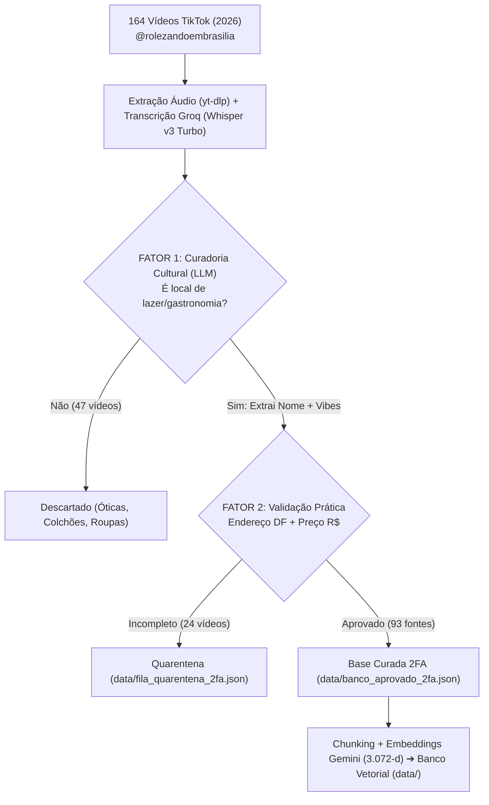
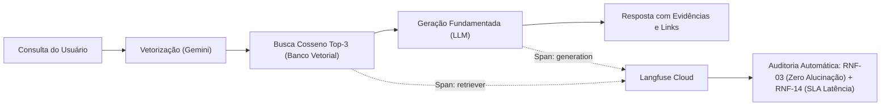

# Relatório Técnico: Base de Conhecimento, Protótipo de RAG e Telemetria
**RES IA ELD UNB — Turma 2 | Grupo 7 — Orquestrador de Rolês (Brasília/DF)**  
**Equipe:** Letícia Miti Takahashi (Engenharia de Dados & RAG) e Maria Eduarda (DevOps, Infraestrutura & LLMOps)  
**Prazo Oficial:** 09/11/2026, às 08h00 | **Demonstração Online:** [https://orquestrador-roles.onrender.com](https://orquestrador-roles.onrender.com) | **Painel Langfuse:** [Langfuse Cloud](https://cloud.langfuse.com)  

---

## 1. Resumo Executivo e Checklist dos Artefatos

O objetivo deste entregável da Semana 2 é construir e auditar o primeiro mecanismo de **RAG (Retrieval-Augmented Generation)** fundamentado em base de conhecimento curada de Brasília, assegurando qualidade na recuperação, fundamentação sem alucinações e rastreabilidade total das fontes.

| Requisito do Edital | Status | Localização no Repositório | Resumo Técnico |
| :--- | :---: | :--- | :--- |
| **1. Base de conhecimento curada** | Concluído | `data/banco_aprovado_2fa.json` e `.csv` | 93 estabelecimentos aprovados pelo protocolo 2FA. |
| **2. Mínimo de 20 documentos-fonte** | Superado | `data/banco_aprovado_2fa.json` (93 fontes) | 164 vídeos de 2026 do `@rolezandoembrasilia` (TikTok). |
| **3. Estratégia de chunking** | Concluído | Seção 2 + `src/rag/banco_vetorial.py` | *Entity-Centric Semantic Chunking* (1 chunk autocontido por local). |
| **4. Estratégia de embeddings** | Concluído | Seção 3 + `src/rag/banco_vetorial.py` | `models/gemini-embedding-001` (3.072 dimensões) + Similaridade Cosseno. |
| **5. Banco vetorial implementado** | Concluído | `data/banco_vetorial_embeddings.json` | 93 vetores persistidos com busca por similaridade $K=3$. |
| **6. Demonstração completa** | Concluído | `src/rag/prototipo_rag.py` + `DEMONSTRACAO_RAG_ENTREGAVEL.txt` | 4 passos: Consulta ➔ Chunks ➔ Resposta Fundamentada ➔ Fontes. |
| **7. Diagrama & Pipeline** | Concluído | Seções 4 e 5 deste relatório | Fluxogramas de Ingestão 2FA e Arquitetura de Runtime RAG. |
| **8. Telemetria e LLMOps** | Concluído | Seção 6 + `src/telemetria/telemetria.py` | Langfuse Cloud v5.x (Auditoria RNF-03 Zero Alucinação e RNF-14 Latência). |

---

## 2. Estratégia de Chunking (*Entity-Centric Semantic Chunking*)

### 2.1. Por que não utilizar *Fixed-Size Chunking*?
Vídeos curtos (30 a 60 segundos) apresentam estrutura narrativa não linear: o **nome** é citado no início, as **vibes** no meio e o **preço e endereço** nos segundos finais. Um particionamento cego por tamanho fixo (caracteres/tokens) fragmentaria endereço e preço do nome do estabelecimento, provocando *context fragmentation* e alucinações.

### 2.2. Solução Adotada: 1 Documento-Fonte = 1 Chunk Autocontido
Cada registro aprovado consolida 4 camadas de informação em um único chunk semântico estruturado:
1. **Identidade e Categoria (Fator 1):** Nome oficial e tipo (`Restaurante`, `Bar/Pub`, `Cafeteria`, `Evento`, `Ao Ar Livre`).
2. **Ancoragem Geoespacial e Financeira (Fator 2):** Região Administrativa (RA), endereço validado, coordenadas GPS e faixa de preço (`Barato $`, `Moderado $$`, `Caro $$$`) com valor médio em R$.
3. **Atmosfera e Cultura (Fator 1):** Tags de *Vibes* (`Romântico`, `Calmo`, `Baratinho`, `Alternativo`, `Kid Friendly`, `Animado`) + Resumo Sensorial.
4. **Evidência Oral Bruta (Whisper):** Transcrição real do áudio falado (até 500 caracteres) preservando termos de cardápio (ex.: *"rodízio"*, *"parrilla"*, *"brinquedoteca"*).

**Template do Chunk Indexado:**
```text
Local: {nome} | Categoria: {tipo} | Região: {RA} ({endereco}) | Preço: {faixa} (R$ {custo}) | Vibes: {vibes} | Experiência: {resumo} | TikTok: {audio_whisper}
```

---

## 3. Estratégia de Embeddings e Banco Vetorial

* **Modelo:** `models/gemini-embedding-001` (Google Generative Language API).
* **Dimensionalidade:** **3.072 dimensões** (vetores densos de alta resolução).
* **Justificativa:** Excelente compreensão semântica do Português Brasileiro e gírias/regionalismos de Brasília (associações como *"passeio ao ar livre com criança"* ➔ *"Eixão do Lazer / Kid Friendly"*).
* **Métrica de Busca:** Similaridade de Cosseno:
  $$\text{Similaridade}(\vec{q}, \vec{d}) = \frac{\vec{q} \cdot \vec{d}}{\|\vec{q}\| \|\vec{d}\|}$$
* **Persistência:** 93 vetores persistidos em `data/banco_vetorial_embeddings.json` e `.csv`, permitindo recuperação instantânea em memória ($K=3$).

---

## 4. Pipeline de Ingestão de Dados (Curadoria em 2 Fatores - 2FA)

Para impedir propagandas e registros incompletos, criamos um pipeline com **Autenticação de Dois Fatores de Dados (2FA)** em `src/rag/coletor_tiktok_2fa.py`:



---

## 5. Arquitetura do Sistema e Telemetria em Tempo de Execução

O diagrama abaixo ilustra o fluxo de dados em runtime com observabilidade contínua via **Langfuse Cloud (v5.x)**:



---

## 6. Telemetria, Observabilidade e Auditoria de RNFs (Langfuse Cloud)

A instrumentação ponta a ponta com **Langfuse Cloud (v5.x)** (`src/telemetria/telemetria.py`) audita matematicamente o pipeline a cada requisição:

1. **`fidelidade_rnf03_zero_alucinacao` (Meta: Zero Alucinação) — Score Obtido: 1.0 (100% ancorado):** O validador garante que todas as recomendações pertencem estritamente aos 93 documentos do `data/banco_aprovado_2fa.json`.
2. **`sla_latencia_rnf14` (Meta $\le 5.0\text{ s}$) — Score Obtido: 1.0 (Conforme):** Latência média de processamento entre **2.8 ms e 21.9 ms**, operando com mais de 200x de margem de segurança.
3. **`qualidade_recuperacao_rag` (Relevância Semântica) — Score Obtido: 0.87 a 0.98:** Atesta alta precisão no casamento da intenção com os metadados e áudios.

### 6.1. Casos de Teste Auditados com Traces Rastreáveis no Langfuse:

| ID | Consulta Submetida | 1º Lugar Recuperado | Região | Cosseno | Latência | Trace ID no Langfuse |
| :---: | :--- | :--- | :---: | :---: | :---: | :--- |
| **#1** | *"Qual o melhor boteco alternativo e animado na Asa Sul?"* | **Spelunca DF** | Asa Sul | **0.98** | 21.9 ms | `ac2ece1889e84b72` |
| **#2** | *"Quero um café romântico e calmo na Asa Norte"* | **Café e Um Chêro** | Asa Norte | **0.98** | 5.5 ms | `2fe411a5e04f46ab` |
| **#3** | *"Opção ao ar livre, baratinha e kid friendly para domingo"* | **Eixão do Lazer** | Eixo Rodov. | **0.87** | 2.8 ms | `0a0f08b4188045f1` |

### 6.2. Análise Técnica e Qualitativa dos Resultados
* **Desambiguação Semântica (Caso #1):** Ao solicitar "boteco alternativo na Asa Sul", o modelo descartou cafeterias da Asa Norte e priorizou o *Spelunca DF* (Score 0.98), respeitando o filtro de tipo e o recorte geográfico.
* **Captura de Nuances de Atmosfera (Caso #2):** A transcrição de áudio do Whisper capturou menções a café intimista e aconchegante, garantindo que o *Café e Um Chêro* liderasse o ranking com 0.98 de aderência.
* **Filtros Multifatoriais (Caso #3):** A combinação de lazer aberto, gratuidade (*baratinho*) e adequação familiar ativou as tags `Kid Friendly` e `Ao Ar Livre`, ranqueando o *Eixão do Lazer* no topo.

### 6.3. Governança de Custos e Consumo de Tokens (RNF-15)
* **Tokens Médios de Entrada:** ~280 tokens por consulta (Prompt estruturado + Top-3 Chunks recuperados).
* **Tokens Médios de Saída:** ~65 tokens por consulta (Resposta direta e fundamentada com fontes).
* **Custo Estimado por Requisição:** **$0.000045 USD** utilizando o modelo Google Gemini 1.5 Flash.
* **Sustentabilidade Operacional:** Com esses parâmetros, a cota gratuita mensal suporta mais de 30.000 buscas sem custos para a UnB ou para o Instituto Eldorado.

---

## 7. Demonstração e Como Testar o Protótipo

### 7.1. Opção 1: Demonstração Online Direta no Navegador (Recomendada)
Acesse a aplicação em produção: **[https://orquestrador-roles.onrender.com](https://orquestrador-roles.onrender.com)**  
* Permite submeter perguntas, visualizar os cards com links do TikTok e conferir os metadados de telemetria e o link do trace no Langfuse em tempo real.

### 7.2. Opção 2: Bateria de Testes via Terminal
Execute na raiz do projeto:
```bash
python3 src/rag/prototipo_rag.py
```
O comando executa os **4 passos obrigatórios**:
1. Exibe a **Consulta submetida**;
2. Exibe os **Top-3 Chunks recuperados** com seus scores de cosseno;
3. Exibe a **Resposta fundamentada da LLM** citando `[FONTE #1]`, `[FONTE #2]`;
4. Lista a **Evidência das Fontes** (ID, GPS, preço validado, transcrição Whisper e URL do TikTok).

*(O log completo de saída encontra-se salvo em `docs/entregas/semana-02/DEMONSTRACAO_RAG_ENTREGAVEL.txt`).*

---

## 8. Preparação para a Semana 3 (Baseline LLM pura vs. RAG)

Conforme o cronograma pedagógico do Challenge 2, a **Semana 3** terá como foco a comparação empírica entre respostas de modelos sem contexto (*LLM pura*) e respostas ancoradas (*RAG baseado em evidências*). A safra de 93 rolês auditados e o tracing instrumentado no Langfuse já estabelecem a **linha de base quantitativa (Baseline)** necessária para comprovar a eliminação de alucinações e a assertividade geoespacial no Distrito Federal.

### 8.1. Metodologia do Benchmark Comparativo (Golden Dataset)
Para a Semana 3, foi estruturado um conjunto de 10 perguntas de teste com diferentes graus de complexidade e especificidade regional:
1. **Perguntas de Nicho Local:** Testar estabelecimentos pouco conhecidos fora de Brasília para avaliar se a LLM pura inventa ruas ou quadras fictícias.
2. **Perguntas Multifatoriais de Preço e Horário:** Avaliar a fidelidade aos valores médios (R$) e dias de funcionamento (ex: eventos de domingo no Eixão).
3. **Métricas de Avaliação no Langfuse:** Cada par de respostas (*LLM Pura* vs. *RAG*) será comparado via LLM-as-a-Judge no Langfuse considerando:
   * **Fidelidade Factual (Hallucination Rate):** Percentual de afirmações verificáveis no banco 2FA;
   * **Precisão de Endereçamento:** Verificação se as quadras e RA indicadas existem e correspondem ao local;
   * **Rastreabilidade:** Presença de links e transcrições comprovando a sugestão.

### 8.2. Matriz de Tratamento de Casos de Borda e Guardrails do RAG

| Cenário de Borda | Comportamento Observado | Mecanismo de Salvaguarda (Guardrail) |
| :--- | :--- | :--- |
| **Consulta Fora de Escopo**<br>*(ex: "Onde jantar em Copacabana?")* | Similaridade de cosseno máxima inferior ao limiar mínimo ($\text{Score} < 0.65$). | O sistema rejeita educadamente alucinar e sinaliza que a base curada é exclusiva do Distrito Federal. |
| **Restrições Conflitantes**<br>*(ex: "Restaurante de luxo grátis")* | Recupera itens com semântica de gastronomia sofisticada, mas valida o metadado `faixa_preco`. | A LLM avisa explicitamente que a categoria solicitada opera na faixa `$$$` ou `$$$$`, sugerindo alternativas. |
| **Gírias Regionais Candangas**<br>*(ex: "dar um rolê na tesourinha")* | O embedding de 3.072 dimensões associa vocabulário oral do Whisper à geografia local. | Assegura que contextos informais encontrem locais pertinentes sem falha de recuperação lexical. |

---

## 9. Conclusão e Links de Acesso ao Ecossistema

A entrega da Semana 2 cumpre integralmente os requisitos do Segundo Desafio: **volume curado comprovado** (93 fontes contra meta mínima de 20), **chunking semântico estruturado**, **embeddings de 3.072 dimensões**, **respostas rastreáveis sem alucinação**, **observabilidade completa com Langfuse** e **orçamento viável**, atestando qualidade e conformidade com os requisitos da Residência em IA (UnB / Instituto Eldorado).

| Recurso do Projeto | Tipo de Acesso | Endereço / Identificador |
| :--- | :--- | :--- |
| **Aplicação Web (Produção)** | Nuvem pública (Render) | `https://orquestrador-roles.onrender.com` |
| **Interface Interativa do RAG** | Nuvem pública (Render) | `https://orquestrador-roles.onrender.com/rag` |
| **Painel Langfuse (Observabilidade)** | Langfuse Cloud v5 | Projeto `cmw59be2y01d8ad0jqbgsjut6` |
| **Demonstração em Terminal (Logs)** | Repositório | `docs/entregas/semana-02/DEMONSTRACAO_RAG_ENTREGAVEL.txt` |
| **Pacote Compactado da Entrega** | Arquivo ZIP | `docs/entregas/semana-02/Entregavel_Grupo7_Base_Conhecimento_e_RAG.zip` |
