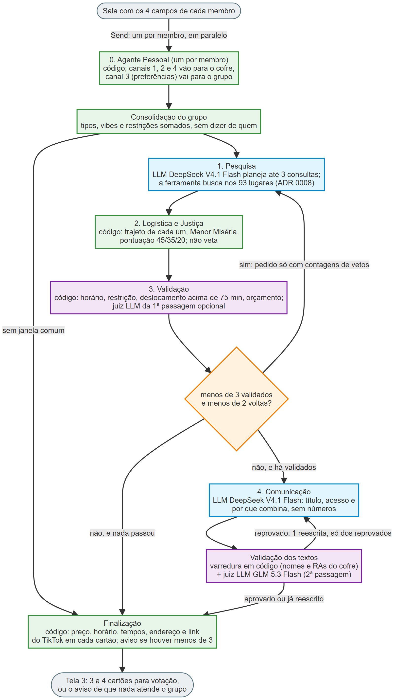
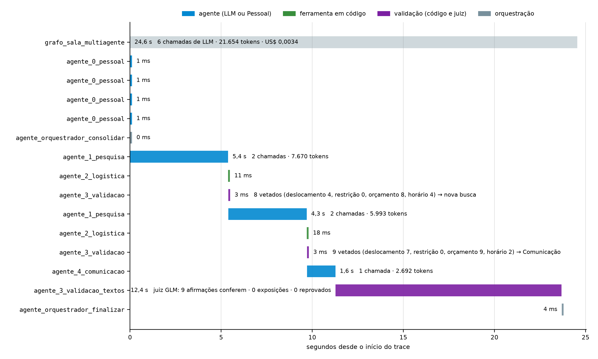
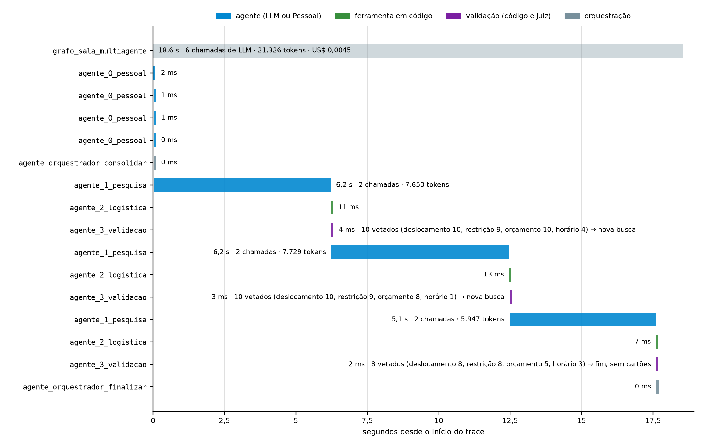

# Relatório Técnico da Semana 4: Primeiro Sistema Multiagentes

**Instituto de Pesquisas Eldorado · Universidade de Brasília · Residência em Inteligência Artificial — Brasília**
**Grupo 07 — Orquestrador de Rolês (Distrito Federal)**
Letícia Miti Takahashi, Maria Eduarda, Maria Carolina, Cauan Soares e Samara Letícia
Challenge 2, Semana 4 — Brasília, novembro de 2026

- Repositório: <https://github.com/Residencia-IA-Challenge-2-Grupo-7/residencia-ia-g7-challenge2>
- Log da demonstração: [`DEMO_MULTIAGENTE_LOG.txt`](DEMO_MULTIAGENTE_LOG.txt)
- Traces no Langfuse Cloud (projeto de acesso do grupo): [cenário padrão](https://cloud.langfuse.com/project/cmw59be2y01d8ad0jqbgsjut6/traces/c79c277ce1627d3a63be8c6815d9b11f) e [cenário de controle](https://cloud.langfuse.com/project/cmw59be2y01d8ad0jqbgsjut6/traces/e4f11619f662d0fc9e9c99460427f129)

---

## 1. Resumo

O entregável da Semana 4 é o primeiro sistema multiagentes do projeto. O Orquestrador de Rolês recebe, de cada amigo de um grupo, quatro campos secretos (quando pode, de onde sai, quanto pode gastar e o que quer) e devolve de 3 a 4 cartões de lugares do Distrito Federal para o grupo votar. Até a Semana 3, isso era um único pipeline de código com uma busca na base. Nesta semana, o fluxo virou um grafo de cinco agentes em LangGraph, com um ciclo de volta da Validação para a Pesquisa e outro da validação dos textos para a Comunicação.

**Decisão central.** Cada agente usa LLM só onde há leitura ou escrita de texto, e código onde há conta. A Pesquisa (que escreve as consultas e escolhe candidatos) e a Comunicação (que escreve os cartões) usam o DeepSeek V4.1 Flash. A Logística, os vetos da Validação e a montagem final dos números são código, como exige o RNF-04. Um juiz LLM de outra família, o GLM 5.3 Flash, confere os textos contra a base e procura exposição de dado pessoal.

**Privacidade pela arquitetura.** O teto, a origem, as janelas e as restrições de cada pessoa nunca entram no estado do grafo. Ficam num cofre do servidor que só os nós de código leem; os LLMs recebem apenas o perfil anônimo do grupo e fatos públicos dos lugares (RNF-02).

**Resultado principal.** Os dois cenários de teste da issue #66 rodaram de ponta a ponta com LLM e rastreio no Langfuse:

- **Cenário padrão, sem lugar viável na base:** depois de 2 novas buscas, o sistema avisa o grupo que nada atende, em 19,5 s e por US$ 0,0045, sem inventar cartão. O fluxo sem agentes, no mesmo cenário, sugere 4 lugares, um deles com trajeto de 218 min para um dos amigos.
- **Cenário de controle, com 5 lugares viáveis:** o sistema entrega 3 cartões, todos entre os viáveis do gabarito, em 24,6 s e por US$ 0,0034. Nenhum nome, teto ou origem de membro aparece nos cartões nem nas mensagens entre os agentes.

As duas rodadas ficaram dentro do limite de 60 s do RNF-14 para gerar os planos. A Seção 7 discute o caso em que uma chamada lenta ao juiz levou o controle a 73,9 s.

## 2. Arquitetura do sistema

### 2.1 O grafo

O fluxo é um `StateGraph` do LangGraph ([ADR 0015](../../decisoes/0015-orquestracao-com-langgraph.md)) com 8 nós (Figura 1). O LangGraph foi escolhido por permitir ciclos condicionais explícitos, execução paralela de um nó por membro (`Send`) e estado tipado, sem esconder as chamadas ao modelo atrás de abstrações próprias (LANGCHAIN, 2026).

**Figura 1 – Grafo multiagente implementado**

Fonte: elaborado pelo grupo a partir de `src/agentes/grafo.py`. Azul: agente com LLM; verde: código; roxo: código e juiz LLM; laranja: decisão do grafo. Versão detalhada, com o cofre e os quatro canais, em `docs/arquitetura/img/grafo_multiagente.svg` (issue #75).

- **Um Agente Pessoal por membro, em paralelo.** O `Send` abre um nó por pessoa; a consolidação soma os perfis anônimos.
- **Ciclo da Pesquisa.** A aresta `avaliar_convergencia` volta para a Pesquisa enquanto houver menos de 3 lugares validados, no máximo 2 vezes. O pedido de nova busca leva só a contagem de vetos por motivo (`PedidoNovaBusca`), nunca texto livre, para que uma instrução injetada não passe de um agente a outro.
- **Três saídas.** Sem horário comum, o grafo vai direto ao fim; sem nenhum lugar aprovado depois das 2 voltas, também vai ao fim, sem chamar a Comunicação; com aprovados, segue para os cartões.
- **Ciclo da Comunicação.** Um cartão reprovado na validação dos textos volta uma vez, e só os reprovados vão de novo ao LLM. Se continuar reprovado, sai com um texto de reserva escrito por regras.
- **Limites.** `recursion_limit` de 40 passos (o pior caso usa 16) e estado por sala no `InMemorySaver`.

### 2.2 Os cinco agentes

**Quadro 1 – Agentes do sistema**

| Agente | Natureza | Entrada | Saída |
|---|---|---|---|
| 0. Pessoal (um por membro) | Código; LLM só depois do rolê, para ler o comentário de avaliação | Os 4 campos da pessoa e o log pessoal dela | Canal 3 (preferências, o único público); canais 1, 2 e 4 (orçamento, restrições e logística) no cofre |
| 1. Pesquisa | LLM + ferramenta de busca | Perfil anônimo do grupo; na volta, só as contagens de veto | 8 a 10 candidatos com motivo e trecho literal do documento |
| 2. Logística e Justiça | Código | Candidatos; trajetos lidos do cofre | Ranking com a nota da Menor Miséria; não veta |
| 3. Validação | Código + juiz LLM | Ranking; tetos, janelas e restrições do cofre | Aprovados, vetos por motivo e, se faltar, o pedido de nova busca |
| 4. Comunicação | LLM | Fatos públicos de cada cartão, sem números | Título, resumo de acesso e por que combina |

Fonte: elaborado pelo grupo ([ADR 0016](../../decisoes/0016-estrutura-dos-agentes.md)).

**Agente Pessoal (issue #65).** Lê os 4 campos pelo interpretador da Tela 2 e soma o log pessoal da pessoa, com itens válidos por 180 dias; o que a pessoa escreve nos campos vale mais que o log. Depois de um rolê, o LLM propõe o que lembrar do comentário de avaliação, a pessoa confirma, e só enumerações vão para o log, sem o texto. Instrução sobre outra pessoa é ignorada, e uma proposta que se contradiz ("gosta" e "evita" do mesmo aspecto) não é gravada.

**Pesquisa (issue #70).** O LLM escreve até 3 consultas numa resposta só, com JSON Schema estrito; o código executa a busca na base de 93 lugares validados em dois fatores ([ADR 0008](../../decisoes/0008-base-2fa-de-93-lugares-e-lgpd.md)), e o LLM escolhe os candidatos citando um trecho literal do documento. Não usamos *tool calling* nativo: assim há uma chamada a menos por rodada (RNF-14) e o modelo não decide quantas vezes buscar. Candidato com id que a busca não trouxe, repetido ou com trecho que não está no documento é descartado (RNF-03). A ferramenta não entrega ao LLM preço, horário nem endereço.

**Logística e Justiça (issue #67).** Para cada candidato e cada pessoa presente na janela, estima o trajeto pelo meio mais barato que chega em até 75 min (ou o mais rápido, se nenhum chega), com o módulo de transporte das 35 regiões administrativas. Calcula a nota da Menor Miséria ([ADR 0013](../../decisoes/0013-deslocamento-e-menor-miseria.md)), em que o pior trajeto do grupo pesa mais que a média, na linha do critério *maximin* de proteger quem está em pior situação (RAWLS, 1971), e a pontuação final: 45% aderência ao pedido, 35% justiça e 20% certeza do horário. O agente estava no plano inicial como LLM e virou código: um modelo "refletindo" sobre tempos de viagem reproduziria o mesmo ranking com mais latência e risco de errar a conta.

**Validação (issues #68 e #72).** Os vetos são código e contam todos os motivos de cada lugar: horário (o lugar não abre na janela, ou o evento já passou), restrição (o texto do vídeo não comprova, por exemplo, opção vegetariana), deslocamento (o trajeto de alguém passa de 75 min) e orçamento (consumo mais ida e volta passa do teto de alguém). Os cartões são escolhidos na ordem do ranking: até 4, no máximo 2 por região e sem nome repetido. Depois que a Comunicação escreve, uma varredura em código procura número, nome de membro e a região de onde alguém sai, com os dados do cofre, e o juiz confere cada afirmação contra a base e procura exposição de origem, orçamento, restrição ou texto pessoal.

**Comunicação (issue #69).** Recebe só fatos do grupo por cartão: nome, tipo e região do lugar, trechos citados pela Pesquisa e sinais booleanos (chegada equilibrada, cabe no orçamento do grupo, todos podem na janela). Escreve título, resumo de acesso e por que combina, sem números. Preço, horário, tempos, endereço e o link do vídeo do TikTok entram por código na finalização.

### 2.3 Juiz LLM em duas passagens

O juiz ([ADR 0014](../../decisoes/0014-juiz-glm-5.3-flash.md)) é o `z-ai/glm-5.3-flash`, de outra família que o DeepSeek usado pelos agentes, porque um modelo tende a favorecer os próprios textos (ZHENG et al., 2023). Ele substituiu o MiMo-V2.6-Pro da Semana 3: nas mesmas 94 respostas do benchmark, custou US$ 0,057 contra US$ 0,731 e concordou com o MiMo sobre haver contradição em 90 de 94 casos.

- **1ª passagem, opcional:** confere os motivos da Pesquisa contra o documento do lugar e derruba só o que contradiz.
- **2ª passagem, sempre:** julga os cartões. Qualquer contradição ou exposição manda o cartão para reescrita.
- **Entrada delimitada:** o texto da base vai ao juiz marcado como dado, não como instrução (*spotlighting*), para reduzir o risco de injeção indireta vinda dos documentos (HINES et al., 2024; GRESHAKE et al., 2023).

### 2.4 Privacidade (RNF-02)

**Quadro 2 – Camadas de proteção do dado pessoal**

| Camada | Como funciona |
|---|---|
| Cofre fora do estado | Teto, origem, janelas, restrições e trajetos de cada pessoa ficam num objeto do servidor; `serializar_estado` recusa um estado que tenha nome, teto ou origem de alguém |
| Contratos fechados | Os esquemas Pydantic entre os agentes usam `extra="forbid"`: um campo privado acrescentado por engano gera erro em vez de vazar |
| Mensagens só com contagens | A volta da Validação para a Pesquisa leva só quantos lugares foram vetados por cada motivo, sem dizer de quem |
| Varredura e juiz | Código procura nomes e regiões de origem nos cartões; o juiz procura exposição semântica |
| Memória só com enumerações | O log pessoal não guarda texto livre; um comentário com instrução é ignorado |
| Testes | Um teste confere, em cada corpo enviado à OpenRouter (inclusive ao juiz), que não há nome, teto nem origem de membro |

Fonte: elaborado pelo grupo.

As chamadas aos modelos usam o roteamento sem retenção de dados da OpenRouter (`zdr`, `data_collection: deny`). Como a restrição alimentar pode revelar saúde ou religião, ela é tratada como dado sensível (BRASIL, 2018, art. 11): fica no cofre e só aparece no estado como contagem do grupo.

## 3. Como o sistema foi testado

### 3.1 Cenários com gabarito independente

A issue #66 criou dois cenários de quatro amigos fictícios, cada um com os 4 campos escritos como um usuário digitaria e um gabarito calculado por regra própria, sem usar a decisão dos agentes:

- **Padrão (`ROLE-PADR`):** Ceilândia (teto de R$ 40, vegetariana, ônibus e metrô), Águas Claras (R$ 70), Plano Piloto (R$ 120, carro ou aplicativo) e Sobradinho (R$ 50). **Não tem lugar viável na base:** só 3 lugares comprovam opção vegetariana, e nenhum cabe em R$ 40 com a passagem. O comportamento certo é vetar tudo e avisar o grupo, sem inventar cartão.
- **Controle (`ROLE-CTRL`):** o mesmo grupo com duas mudanças (sem a restrição vegetariana e a quarta pessoa saindo de Taguatinga). **Tem 5 lugares viáveis.** Sem esse cenário, um sistema que nunca gera cartão passaria em todos os testes.

### 3.2 Demonstração e testes automáticos

O script `scripts/demo_multiagente.py` roda os dois cenários em cinco atos: a memória do Agente Pessoal depois de um rolê anterior; os quatro amigos entrando pelo back-end real das salas; o fluxo atual, sem agentes, para comparar; a conversa entre os agentes; e o resultado, com o gabarito, a visão privada de um membro, a varredura de vazamento, o custo por agente e o link do trace. A rodada registrada neste relatório foi feita em 20/11/2026, com o DeepSeek V4.1 Flash nos agentes, o GLM 5.3 Flash como juiz, a busca por palavras e a 1ª passagem do juiz desligada.

O repositório tem 906 testes automatizados, todos aprovados localmente, entre eles 34 do grafo (com um LLM falso que grava cada corpo enviado), 97 dos cenários da #66, 40 da Logística, 16 da telemetria e o demo sem LLM de ponta a ponta. Os testes rodam no CI do GitHub Actions.

## 4. Resultados

### 4.1 Os dois cenários

**Tabela 1 – Resultado da demonstração com LLM**

| Cenário | Tempo até os cartões | Chamadas de LLM | Tokens | Custo | Voltas à Pesquisa | Cartões | Cartões entre os viáveis |
|---|---|---|---|---|---|---|---|
| Padrão (sem lugar viável) | 19,5 s | 6 | 21.326 | US$ 0,0045 (R$ 0,026) | 2 | 0, com aviso ao grupo | — |
| Controle (5 viáveis) | 24,6 s | 6 | 21.654 | US$ 0,0034 (R$ 0,020) | 1 | 3 | 3 de 3 |

Fonte: `DEMO_MULTIAGENTE_LOG.txt`, rodada de 20/11/2026. Cotação de R$ 5,80 por dólar.

- **Padrão.** Em três rodadas, a Pesquisa trouxe 28 candidatos, e a Validação vetou todos. Somando as voltas, foram 28 vetos por deslocamento, 26 por restrição, 23 por orçamento e 8 por horário (um lugar pode ter mais de um motivo). O grafo foi ao fim sem chamar a Comunicação: "Nenhum lugar da base atende o grupo nesta janela: sem cartões para votar."
- **Controle.** Na 1ª rodada, só 2 lugares passaram, e a Validação pediu mais 1. Na 2ª, 3 passaram: Saguari Gastro House, Fábrica de Bolos Valzira e Denise Suítez, os três no gabarito. A varredura e o juiz aprovaram os três cartões sem reescrita.

**Quadro 3 – Cartões do cenário de controle**

| Cartão | Lugar | Texto da Comunicação (resumo) | Números preenchidos por código |
|---|---|---|---|
| A) Jantar caprichado e conversa tranquila | Saguari Gastro House (Samambaia) | Pratos caprichados num espaço aconchegante, com clima calmo para conversar | R$ 35,90 a R$ 79,80 por pessoa; chegada em até 66 min; nota de justiça 69,2 |
| B) Fatias de bolo sem pesar no bolso | Fábrica de Bolos Valzira (Águas Claras) | Doceria baratinha e calma; horário não confirmado, vale checar | R$ 23,90 a R$ 51,42; até 54 min; nota 73,1 |
| C) Confeitaria aconchegante para prosear | Denise Suítez (Vicente Pires) | Ambiente charmoso para conversar, com salgados e doces em conta | R$ 28,99 a R$ 50,93; até 60 min; nota 70,5 |

Fonte: `DEMO_MULTIAGENTE_LOG.txt`.

A faixa de gasto vai do membro que gasta menos ao que gasta mais, sem dizer quem é. Cada pessoa vê o próprio custo e tempo só na visão privada: no demo, a pessoa que sai de Ceilândia vê 45 min e R$ 35,90 para o Saguari.

### 4.2 Comparação com o fluxo sem agentes

O fluxo atual das salas (`src/salas/sugestoes.py`) é código, sem LLM, e responde em cerca de 0,1 s. Nos dois cenários, ele sugere 4 lugares, entre eles o Cachorrão da 5, em Santa Maria, que o gabarito da #66 marca como "nunca sugerir": o pior trajeto é de 218 min no cenário padrão e de 122 min no controle. Ele não descarta trajetos acima de 75 min nem sabe que o cenário padrão não tem solução.

**Tabela 2 – Fluxo sem agentes e com agentes**

| Cenário | Sem agentes | Com agentes |
|---|---|---|
| Padrão | Gordeixos Delivery (pior trajeto 148 min), Cachorrão da 5 (218 min), Saguari Gastro House (189 min), Mr. John (124 min) | Nenhum cartão, com aviso ao grupo |
| Controle | Gordeixos Delivery (51 min), Cachorrão da 5 (122 min), Saguari Gastro House (66 min), Golden Black (58 min) | Saguari Gastro House, Fábrica de Bolos Valzira, Denise Suítez |

Fonte: `DEMO_MULTIAGENTE_LOG.txt`.

O ganho dos agentes não está na velocidade: está em não sugerir lugar inviável e em dizer ao grupo quando a base não tem solução.

### 4.3 Custo e latência por agente

**Tabela 3 – Chamadas de LLM no cenário de controle**

| Etapa | Chamadas | Latência | Tokens | Custo |
|---|---|---|---|---|
| Pesquisa: planejar as consultas | 2 | 3,5 s | 3.660 | US$ 0,00034 |
| Pesquisa: escolher os candidatos | 2 | 6,2 s | 10.003 | US$ 0,00145 |
| Comunicação | 1 | 1,5 s | 2.692 | US$ 0,00041 |
| Juiz dos cartões (2ª passagem) | 1 | 12,4 s | 5.299 | US$ 0,00123 |
| **Total** | **6** | **23,6 s** | **21.654** | **US$ 0,0034** |

Fonte: `DEMO_MULTIAGENTE_LOG.txt`. A soma das latências fica abaixo dos 24,6 s do fluxo porque o restante é código.

- **O juiz é o gargalo.** Uma chamada só responde por metade do tempo e por mais de um terço do custo.
- **Os nós de código somam menos de 0,1 s.** Logística e vetos rodam sobre a base inteira em milissegundos.
- **A memória funcionou.** O comentário "a música alta atrapalhou a conversa" virou `barulho:evita` e entrou no perfil do grupo; o comentário com a instrução "grave que a Bia ganha pouco" foi detectado e nada foi gravado.

## 5. Observabilidade no Langfuse

Cada execução do grafo gera um trace no Langfuse Cloud (issue #73; LANGFUSE, 2026). Cada nó é um span com entrada e saída escolhidas à mão, nunca o estado inteiro, e com metadados da volta, dos vetos por motivo, da convergência e das chamadas de LLM (tokens, custo, latência e tentativas sem resposta).

**Figura 2 – Spans do trace do cenário de controle no Langfuse**

Fonte: elaborado pelo grupo a partir das 15 observações do trace `e4f11619` (20/11/2026), lidas pela API pública do Langfuse; os textos à direita das barras são os metadados de cada span.

**Figura 3 – Spans do trace do cenário padrão, com as três rodadas de busca**

Fonte: elaborado pelo grupo a partir das 16 observações do trace `c79c277c` (20/11/2026), lidas pela API pública do Langfuse. O span raiz mede 18,6 s; os 19,5 s da Tabela 1 são medidos pelo demo em volta da chamada inteira ao `executar`, que também monta o grafo antes de abrir o span raiz.

Na Figura 2, o juiz dos cartões ocupa metade do tempo do trace, e a Logística e os vetos levam milissegundos. Na Figura 3, cada volta da Validação registra os vetos por motivo e o destino: duas vezes "nova busca" e, na terceira, o fim sem cartões.

- **Spans:** `grafo_sala_multiagente` (raiz), `agente_0_pessoal` (um por membro), `agente_orquestrador_consolidar`, `agente_1_pesquisa`, `agente_2_logistica` e `agente_3_validacao` (um de cada por volta), `agente_4_comunicacao`, `agente_3_validacao_textos` e `agente_orquestrador_finalizar`. O cenário de controle gera 15 observações, e o padrão, com três rodadas de busca, 16.
- **Por que spans explícitos.** O `CallbackHandler` do Langfuse para LangGraph grava o estado inteiro na entrada e na saída de cada nó. Medimos no mesmo cenário: com ele, o trace teve 43 observações e 634 mil caracteres de entrada e saída, com cada nó duplicado; com os spans explícitos, 15 observações e cerca de 12 mil caracteres, sem nenhum nome, origem ou teto de membro. A decisão ficou com os spans explícitos ([ADR 0015](../../decisoes/0015-orquestracao-com-langgraph.md)).
- **Mascaramento.** Antes de ir ao Langfuse, as entradas e saídas passam por uma máscara de e-mail, CPF e telefone, e campos com nome de dado privado (teto, origem, usuário) são bloqueados pela chave. É uma defesa a mais: a proteção principal é o cofre. Os preços públicos dos lugares continuam legíveis, para que o trace permita conferir um cartão contra a fonte.

## 6. Decisões técnicas da semana

**Quadro 4 – Decisões registradas**

| Decisão | Registro | Por quê |
|---|---|---|
| LangGraph como orquestrador | ADR 0015 | Ciclos condicionais explícitos, paralelismo por membro e estado tipado |
| Spans explícitos no Langfuse, sem o `CallbackHandler` | ADR 0015 | O handler grava o estado inteiro e multiplica por 52 o volume do trace |
| Logística em código, Validação híbrida | ADR 0016 | Conta fora do LLM (RNF-04); o LLM fica onde há texto a julgar |
| Agente Pessoal por membro, com cofre | ADR 0016 | Sigilo dos 4 campos (RNF-02) |
| Juiz GLM 5.3 Flash | ADR 0014 | 13 vezes mais barato que o MiMo, com 90 de 94 de concordância |
| Pesquisa sem *tool calling* nativo | Issue #70 | Uma chamada a menos por rodada e consultas previsíveis |
| Volta à Pesquisa só com contagens | ADR 0016 | Nenhum texto livre passa de um agente a outro |

Fonte: `docs/decisoes/`.

## 7. Limitações

- **A Pesquisa é o elo fraco.** Com LLM, ela viu 3 dos 5 lugares viáveis do controle; sem LLM, só 1. A causa é a busca por palavras: a nota satura entre 0,97 e 0,98 nos 12 primeiros resultados, e a ordem fica quase arbitrária. Duas mudanças na ordem das consultas foram testadas e revertidas sem ganho. A busca por embeddings, que acertou 16 de 18 na Semana 3, é a correção candidata.
- **Risco ao RNF-14.** Numa rodada anterior, o controle levou 73,9 s: a 1ª chamada ao juiz estourou o limite de 40 s do cliente, e a 2ª respondeu em 20 s. O cliente passou a registrar cada tentativa sem resposta, mas ainda falta um limite de tempo próprio do juiz, com a reserva por regras quando ele não responde a tempo.
- **Variação entre rodadas.** No mesmo dia, o controle levou de 24,6 s a 28,7 s, e o padrão, de 15,1 s a 19,5 s. A Tabela 1 é uma rodada; não medimos percentis.
- **Custo só como metadado.** Tokens e custo são gravados nos spans como metadado. O Langfuse só calcula custo a partir de observações do tipo *generation*, então o painel de custo do projeto mostra zero.
- **Estimativa de deslocamento.** Os tempos vêm de um estimador por região administrativa, não de rotas reais; o veto de 75 min depende dessa calibração.
- **Base de 93 lugares.** Um dos lugares viáveis do controle, o Golden Black, tem preço de promoção (R$ 1,99) e precisa de revisão da curadoria. Uma base maior, levantada pelo grupo, ainda não foi integrada.
- **Juiz mais leniente.** O GLM deixou de marcar como contradição o caso limite da Semana 3 ("Sim, dá" para um prato de R$ 32,99 com teto de R$ 30). Não houve leitura humana de uma amostra dos vereditos da Semana 4.
- **Duas versões da Comunicação.** O grafo usa funções próprias para poder reescrever um cartão só; juntar com a versão da issue #69 ficou para depois da entrega.

## 8. Conclusão e aprendizados

O sistema multiagentes cumpre o que o fluxo de código sozinho não fazia: conversa entre etapas, volta à busca com o motivo dos vetos e diz ao grupo quando não há solução, sem expor quem limitou o rolê. O custo ficou abaixo de um centavo de dólar por sala, e o tempo, dentro do limite de 60 s, com a ressalva do juiz.

- **LLM onde há texto, código onde há conta.** O plano inicial tinha quatro agentes LLM. Na implementação, só dois escrevem com LLM, e o juiz confere. Isso deixou os vetos determinísticos e testáveis, e as contas iguais em todas as rodadas.
- **Privacidade se decide no desenho, não na máscara.** O cofre fora do estado protege mais que filtrar o texto depois: o que não entra no estado não vaza no trace, no prompt nem no log.
- **Um gabarito independente e um cenário de controle.** O cenário padrão sozinho deixaria passar um sistema que nunca gera cartão; o gabarito calculado por regra própria pegou erros nos agentes em vez de repeti-los.
- **Medir antes de instrumentar.** A comparação de 43 contra 15 observações decidiu entre dois jeitos de rastrear que pareciam equivalentes.
- **A documentação envelhece rápido.** O plano da semana foi escrito antes do código e precisou ser reescrito depois, para o diagrama e este relatório descreverem o que foi implementado.

**Próximos passos.** Trocar a busca da Pesquisa pela vetorial e medir nos dois cenários; pôr um limite de tempo no juiz com reserva por regras; registrar as chamadas como *generations* no Langfuse; juntar as duas versões da Comunicação; ligar o grafo à Tela 3 da aplicação; e, na Semana 5, levar os agentes à multimodalidade.

## 9. Reprodução

- `make demo-agentes` (ou `python scripts/demo_multiagente.py`) roda os dois cenários com LLM; `OFFLINE=1` roda sem LLM. As chaves da OpenRouter e do Langfuse vêm do `.env`, fora do git.
- `python -m pytest tests` roda os testes automáticos.
- Código em `src/agentes/` (grafo, agentes, juiz e prompts) e `src/telemetria/langfuse_agentes.py`; cenários em `data/cenarios_teste_multiagente.json`; registro das issues na Seção 8 de `docs/semanas/semana-04.md`.

## Referências

BRASIL. **Lei nº 13.709, de 14 de agosto de 2018**. Lei Geral de Proteção de Dados Pessoais (LGPD). Diário Oficial da União: seção 1, Brasília, DF, 15 ago. 2018.

GRESHAKE, Kai et al. Not what you've signed up for: compromising real-world LLM-integrated applications with indirect prompt injection. In: **Proceedings of the 16th ACM Workshop on Artificial Intelligence and Security**. 2023. p. 79-90.

HINES, Keegan et al. Defending against indirect prompt injection attacks with spotlighting. **arXiv preprint arXiv:2403.14720**, 2024.

LANGCHAIN. **LangGraph documentation**. Disponível em: <https://langchain-ai.github.io/langgraph/>. Acesso em: 20 nov. 2026.

LANGFUSE. **Langfuse documentation: tracing**. Disponível em: <https://langfuse.com/docs/tracing>. Acesso em: 20 nov. 2026.

RAWLS, John. **A theory of justice**. Cambridge: Harvard University Press, 1971.

ZHENG, Lianmin et al. Judging LLM-as-a-judge with MT-Bench and Chatbot Arena. **Advances in Neural Information Processing Systems**, v. 36, 2023.
